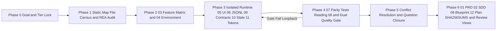

<div align="center">


<br />

[](LICENSE)
[](SKILL.md)
[-3b82f6.svg?style=flat-square)](#생성되는-12종-고정-산출물-0112)
[](#시각동작-실증-명세만으로-클린룸-재구현-검증)
[-0ea5e9.svg?style=flat-square)](#시각동작-실증-명세만으로-클린룸-재구현-검증)

<br />

[English](README.md) · **한국어 (Korean)**

[재구현 실증](#시각동작-실증-명세만으로-클린룸-재구현-검증) · [실측 MIT 예제 3종](#포함된-실측-완료-mit-대표-예제-3종) · [12종 산출물 맵](#생성되는-12종-고정-산출물-0112) · [기존 스킬 비교](#기존-명세-스킬과의-비교) · [60초 검증](#60초-로컬-검증-명령) · [설치 및 사용법](#설치-및-사용법)

</div>

---

## 정적 코드 분석만으로 놓치는 지점과 `spec-anything`의 해법

오픈소스 저장소의 소스 코드만 읽어서는 실제 배포본의 동작과 UI 상태를 정확히 재현할 수 없습니다. `spec-anything`은 **다언어 정적 추출**, **공식 배포본 바이너리/번들 감사(REA)**, **격리된 실구동 런타임·UI 실측**, **실행 가능한 차분 대조 테스트(Differential Parity Test)**를 하나의 폐루프(Closed-Loop) 파이프라인으로 통합합니다.

| 정적 코드 읽기만으로 놓치는 문제 | 포함된 MIT 예제에서 `spec-anything`이 실제 포착한 근거 |
| :--- | :--- |
| **빌드 시점 에셋 교체** | [`usememos/memos 26.11.2`](examples/01-memos-26.11.2/) 소스 저장소의 `244 B` 스텁 `index.html`이 공식 배포 바이너리에서는 `4,781 B` Vite SPA 번들로 교체됨을 REA로 확인 |
| **런타임 전용 API·인증 분기** | Memos의 `PRIVATE` 공유 토큰 `200` 응답, `POST` 생성 시 `pinned: true` 무시, Connect-RPC `HeaderCarrier` 쿠키와 REST 인증 분기를 `06` JSONL로 기록하고 `07` 테스트로 고정 |
| **프레임워크 오판 및 실시간 스트리밍** | [`pocketbase/pocketbase v0.40.6`](examples/02-pocketbase-v0.40.6/) 공식 바이너리가 Svelte가 아닌 바닐라 JS Admin SPA를 내장하고 있으며, 실시간 SSE(`/api/realtime`) 순서 및 SQLite WAL 21개 DDL을 `go version -m`·`otool`과 함께 검증 |
| **상태 저장 타이밍 경계 사례** | [`gabrielecirulli/2048`](examples/03-2048-quickstart/)에서 `Keep going -> 새로고침` 직후 다음 타일 이동 전까지 `keepPlaying`이 저장되지 않아 승리 오버레이가 재출현하는 실제 타이밍 규명 |

---

## 시각·동작 실증: 명세만으로 클린룸 재구현 검증

`spec-anything`의 출력 품질은 정적 문서 설명이 아니라 **실제 클린룸 재구현(Clean-Room Reimplementation)**으로 증명합니다. 원본 소스 코드와 브랜드 상표를 일절 복제하지 않고 `01`–`12` 명세·계약·UI 토큰만으로 별도 언어/코드베이스에 재구현한 뒤, **수정하지 않은 `07` 대조 테스트**와 Playwright 픽셀 차분 히트맵으로 자동 검증했습니다.


- **Go 공식 바이너리 → Python 클린룸 (`PocketBase v0.40.6`)**: 수정 없는 `07_tests/verify_parity.py --target-url`로 **`13 / 13 PASS`** (`reimplementation_diff` 모드 — `400`/`200` 인증, `401` 보호, 동적 DDL, 유효성·유일성 오류 코드, `fexpr` 필터·정렬, **실시간 SSE `/api/realtime` 이벤트 순서**, 백업 ZIP 생성, **Playwright 로그인 픽셀 차분 `1.12% <= 5.00%`**).
- **원본 JS → 클린룸 JS/CSS (`gabrielecirulli/2048`)**: 수정 없는 `07-compare.cjs`로 전체 이벤트 시퀀스, `localStorage` 직렬화, `Keep going -> reload` 경계 사례까지 **`11 / 11 deepEqual PASS`**.
- **대화형 좌우 스와이프 비교기**: 로컬 브라우저에서 [`assets/reimpl-proof-interactive.html`](assets/reimpl-proof-interactive.html)을 열면(한/영 전환 버튼 포함) 원본과 클린룸 화면을 슬라이더로 직접 비교할 수 있습니다.

---

## 포함된 실측 완료 MIT 대표 예제 3종


| # | 예제 경로 | 대상 저장소 (MIT) | Stars | 핵심 시연 포인트 | 실측 검증 결과 |
| :---: | :--- | :--- | :---: | :--- | :--- |
| **01** | [`examples/01-memos-26.11.2/`](examples/01-memos-26.11.2/) | [`usememos/memos`](https://github.com/usememos/memos) `26.11.2` | 64.7k | **대표 풀스택 일상 앱**: Go + React + SQLite + Connect-RPC, 데스크톱·모바일(`390x844@2x`) 8화면, REA·런타임 괴리 5건, `SIGTERM` 재시작 복구 | `11 / 11` 대조 · `9 / 9` 게이트 · 비밀 유출 `0` |
| **02** | [`examples/02-pocketbase-v0.40.6/`](examples/02-pocketbase-v0.40.6/) | [`pocketbase/pocketbase`](https://github.com/pocketbase/pocketbase) `v0.40.6` | 61.6k | **백엔드·실시간 SSE·재구현 실증**: Go + 바닐라 JS SPA + SQLite WAL + SSE `/api/realtime`, 6화면, 21개 DDL, Mach-O·`go version -m` REA 감사, PM/Dev HTML·PDF·DOCX·SVG 리뷰, Python [`cleanroom-reimpl/`](examples/02-pocketbase-v0.40.6/cleanroom-reimpl/) 포함 | `16 / 16` 원본 · `13 / 13` 재구현 (`1.12%` MAE) · `13 / 13` 게이트 |
| **03** | [`examples/03-2048-quickstart/`](examples/03-2048-quickstart/) | [`gabrielecirulli/2048`](https://github.com/gabrielecirulli/2048) | 13.5k | **외부 의존성 0 · 0.1초 퀵스타트**: 순수 Node.js `06 -> 07` 폐루프 대조(`Keep going -> reload`), JS/CSS [`cleanroom-reimpl/`](examples/03-2048-quickstart/cleanroom-reimpl/) 포함 | `11 / 11` 원본 · `11 / 11` 클린룸 (`0.1s`) |

---

## 생성되는 12종 고정 산출물 (`01`–`12`)

모든 분석 대상은 동일한 **12개 고정 산출물 체계**로 생성되며 `Feature ID(F-001)`, `Evidence ID(EV-001)`, `Screen ID(SCR-001)` 외래 키로 전 구간이 연결되고 `SHA256SUMS.txt`와 13개 기계 검증 게이트로 봉인됩니다.


---

## 7단계 폐루프 파이프라인 아키텍처



---

## 기존 명세 스킬과의 비교

[`daishir0/cc-rsg`](https://github.com/daishir0/cc-rsg)의 재개형 상태 머신·다언어 정적 추출·안티매크로 품질 게이트와 [`WindowHyun/Reverse_Spec_and_PRD`](https://github.com/WindowHyun/Reverse_Spec_and_PRD)의 파서 팩트 경계·비밀 마스킹·이중 독자 HTML/PDF/DOCX/SVG 렌더러를 흡수한 뒤, **공식 배포본 REA 감사 + 실구동 런타임·UI 실측 + 실행 가능한 차분 대조 테스트**를 통합했습니다.

| 기능 항목 | Greenfield SDD (`spec-kit`) | Frontend Reverse Planning (`Reverse_Spec_and_PRD`) | Static Reverse Spec (`cc-rsg`) | `spec-anything` |
| :--- | :---: | :---: | :---: | :---: |
| 결정론적 다언어 정적 추출 + Git 전체 파일 전수 조사 | — | — | ✓ | ✓ |
| 재개 가능한 7단계 상태 머신 (`state.json`) 및 질문 뱅크 | — | — | ✓ | ✓ |
| 비밀 마스킹 및 `file://` SSRF 차단 HTML/PDF/DOCX 리뷰 렌더러 | — | ✓ | — | ✓ |
| 공식 배포본 바이너리·아카이브·번들 REA 감사 (`SHA-256`) | — | — | — | ✓ |
| 격리된 실구동 런타임 실측 (`06` JSONL: HTTP, RPC, SSE, SQLite, 재시작) | — | — | — | ✓ |
| 다상태 UI 기준선 캡처 (`05`) + 실측 CSS 디자인 토큰 (`11`) | — | — | — | ✓ |
| 기계 판독 계약 (`09`: OpenAPI 3.1, JSON Schema, SQLite DDL) | — | — | — | ✓ |
| `06` 근거를 직접 읽는 실행형 대조 테스트 (`07`) + 시각 픽셀 차분 | — | — | — | ✓ |

---

## 60초 로컬 검증 명령

저장소를 내려받은 뒤 아래 4개 명령으로 모든 예제와 품질 게이트를 즉시 재검증할 수 있습니다.

```bash
# 1. 외부 의존성 0 · 0.1초 퀵스타트 (2048 원본 + 클린룸 재구현본 동시 대조)
node examples/03-2048-quickstart/07-compare.cjs examples/03-2048-quickstart/upstream
node examples/03-2048-quickstart/07-compare.cjs examples/03-2048-quickstart/cleanroom-reimpl

# 2. PocketBase 대표 번들 13개 정적·동적·SQLite·비밀·SHA-256 게이트 검증
python3 scripts/validate_bundle.py examples/02-pocketbase-v0.40.6 --tier T3 --verify-checksums

# 3. Memos 대표 번들 정적·동적·SQLite DDL·비밀 게이트 검증
python3 examples/01-memos-26.11.2/scripts/validate_bundle.py --bundle examples/01-memos-26.11.2

# 4. 저장소 전체 비밀 유출 검사 (0건 확인)
python3 scripts/secret_guard.py . --fail-on-hit
```

---

## 설치 및 사용법

### Claude Code / Codex CLI / OpenBot 설치

```bash
mkdir -p ~/.claude/skills/spec-anything
cp -r SKILL.md LICENSE schemas scripts agents references templates ~/.claude/skills/spec-anything/
```

**실행 요구 사항**:

- **기본 (`T1`–`T2`)**: Python `3.10+` 표준 라이브러리만으로 상태 관리, 정적 추출, 파일 전수 조사, REA 감사, 비밀 검사 실행 가능.
- **전체 `T3` UI 캡처 및 리뷰 문서 생성**: `pip install jsonschema markdown pillow playwright python-docx && playwright install chromium`.

### 에이전트 호출 예시

```text
spec-anything 스킬로 https://github.com/pocketbase/pocketbase (태그 v0.40.6, 티어 T3)를 분석해줘.
공식 배포 바이너리 REA 감사와 격리된 임시 워크스페이스 실구동 API/SSE/UI 실측을 수행하고,
01–12 산출물과 07 대조 테스트 및 validate_bundle.py 통과까지 완료해줘.
```

---

## 포함된 결정론적 자동화 스크립트 (`scripts/`)

<details>
<summary><strong>7개 자동화 스크립트 역할 펼치기</strong></summary>

| 스크립트 | 책임 범위 |
| :--- | :--- |
| `scripts/state_manager.py` | 7단계 재개형 상태 머신 (`.spec-anything/state.json`), `goal.json`, `questions.json` 질문 뱅크 관리 |
| `scripts/source_map.py` | 다언어 정적 구조 추출기 (Go, TS/JS, Svelte, Vue, Python, Rust, SQL, HTML, CSS) 및 미분석 경고 출력 |
| `scripts/file_inventory.py` | Git 커밋 추적 파일 전수 조사 및 `03` 기능 ID·제외 사유 대조 검증 |
| `scripts/inspect_release.py` | 공식 배포본 아카이브·바이너리 REA 감사 (SHA-256, `checksums.txt`, `go version -m`, `otool`, `codesign`) |
| `scripts/secret_guard.py` | API 키, PEM 개인키, 원문 JWT 자동 탐지 및 마스킹 |
| `scripts/validate_bundle.py` | 13개 게이트 이중 기계 검증기 (12종 고정 산출물, `[REF:]`, `## Sources Read`, 매크로 비율, 구조 전용 Mermaid, JSON Schema, 외래 키 정합성, `06->07` 연결, OpenAPI/SQLite 실행, 비밀, `SHA256SUMS.txt`) |
| `scripts/render_review.py` | PM/Design 및 Dev/QA 이중 독자 단일 HTML, SVG, DOCX, `file://` SSRF 차단 PDF 리뷰 렌더러 |

</details>

---

## 클린룸 범위 및 라이선스

권한이 있는 오픈소스 기능 재구현, 언어 포팅, 상호운용성 검증 목적으로만 사용합니다. 취약점 악용, 접근 제어·DRM 우회, 저작권이 있는 UI 에셋·폰트·상표의 무단 재배포는 범위에 포함하지 않습니다.

**MIT 라이선스**([`LICENSE`](LICENSE))로 배포됩니다.
