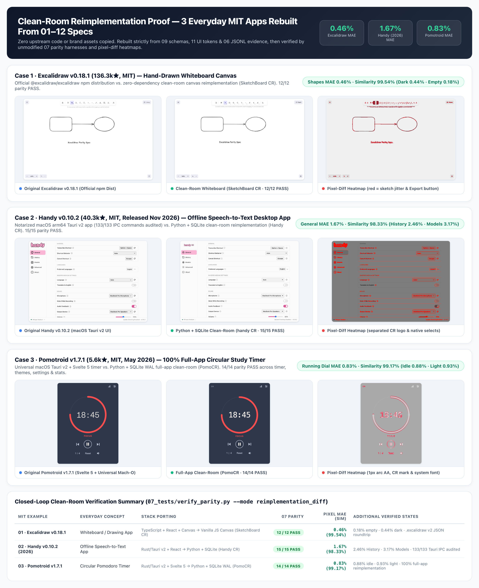
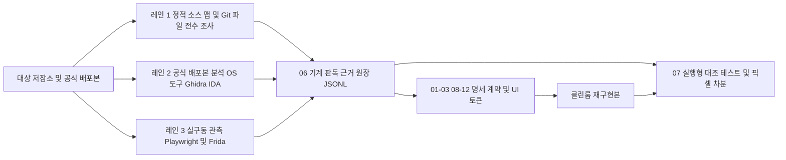
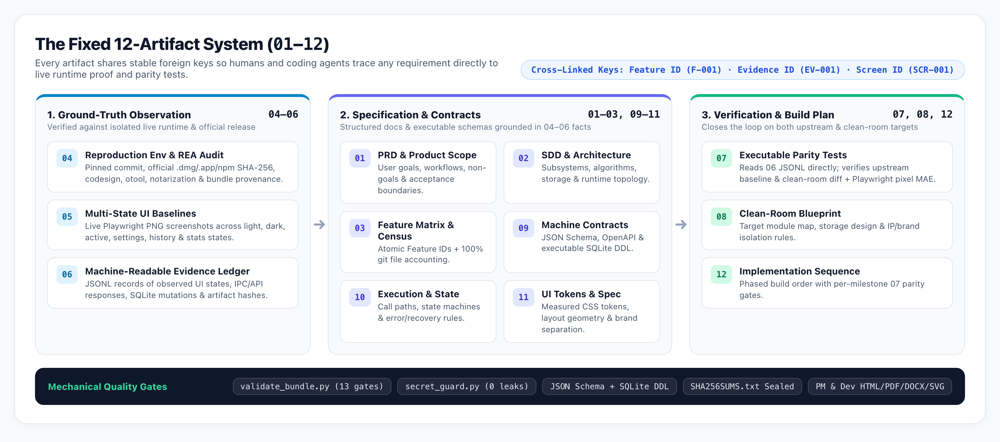
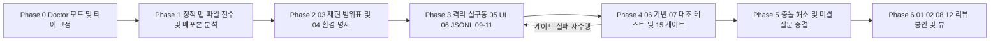

<div align="center">

# spec-anything

**어떤 오픈소스 앱이든 검증된 클린룸 명세서로 바꾸고, 명세만으로 다시 만든 앱이 원본과 똑같이 동작하는지 자동 증명합니다.**

[](LICENSE)
[](SKILL.md)
[](#예제-미리보기)

[English](README.md) · **한국어**

[예제 미리보기](#예제-미리보기) · [동작 방식](#동작-방식) · [빠른 시작](#빠른-시작) · [상세 기전](#상세-기전-내부-동작-원리)

</div>

---

<table>
  <tr>
    <td width="25%" valign="top">
      <strong>실제 소프트웨어를 직접 조사</strong><br/>
      소스 코드, 공식 배포본(<code>.dmg</code>, <code>.app</code>, npm), 실제 실행 화면을 함께 점검합니다.
    </td>
    <td width="25%" valign="top">
      <strong>Clean-Room / Deep 모드</strong><br/>
      공개 화면·입출력만 관찰하는 <code>clean-room</code>과 소스·역컴파일·동적 추적까지 여는 <code>deep</code>을 분리합니다.
    </td>
    <td width="25%" valign="top">
      <strong>추측이 아닌 실행 검증</strong><br/>
      12종 교차 연결 명세서, RFC 2119·GIVEN-WHEN-THEN 계약, 실행형 대조 테스트와 픽셀 차분 히트맵을 생성합니다.
    </td>
    <td width="25%" valign="top">
      <strong>에이전트 즉시 연동</strong><br/>
      Claude Code, Codex CLI, OpenBot과 Ghidra, IDA, Frida를 잇는 10개 스크립트와 3개 전문 서브에이전트를 제공합니다.
    </td>
  </tr>
</table>

## 예제 미리보기

아래 3개 예제는 원본 소스 코드와 브랜드 자산을 전혀 복사하지 않고, 생성된 명세서만으로 처음부터 다시 구현해 자동 검증했습니다.



| 앱 (MIT) | 한 줄 설명 | 대조 테스트 | 화면 일치율 | 산출물 |
| :--- | :--- | :---: | :---: | :--- |
| [**Excalidraw**](https://github.com/excalidraw/excalidraw) `v0.18.1` | 손그림 화이트보드 그림판 | `12 / 12` | `99.5%` (`0.46%` MAE) | [명세](examples/01-excalidraw-v0.18.1/) · [재구현](examples/01-excalidraw-v0.18.1/cleanroom-reimpl/) |
| [**Handy**](https://github.com/cjpais/Handy) `v0.10.2` *(2026)* | 오프라인 음성 받아쓰기 앱 | `15 / 15` | `98.3%` (`1.67%` MAE) | [명세](examples/02-handy-v0.10.2/) · [재구현](examples/02-handy-v0.10.2/cleanroom-reimpl/) |
| [**Pomotroid**](https://github.com/Splode/pomotroid) `v1.7.1` | 원형 뽀모도로 공부 타이머 | `14 / 14` | `99.2%` (`0.83%` MAE) | [명세](examples/03-pomotroid-v1.7.1/) · [재구현](examples/03-pomotroid-v1.7.1/cleanroom-reimpl/) |

> 로컬 브라우저에서 [`assets/reimpl-proof-interactive.html`](assets/reimpl-proof-interactive.html)을 열면 6개 화면을 좌우 슬라이더로 비교할 수 있습니다 (한·영 지원).

## 동작 방식

1. **코드·공식 배포본 동시 점검** — 고정된 커밋 소스와 실제 공식 배포 패키지(`.dmg`, `.app`, ELF/PE, npm 배포본)를 함께 대조합니다.
2. **격리 실행 실측** — 앱을 격리 환경에서 직접 구동해 다상태 화면 캡처, 실측 CSS 토큰, 스키마, 실제 상태 전이를 기록합니다.
3. **12종 명세·대조 테스트 생성** — 고정된 12개 산출물(`01`–`12`)과 원본·클린룸 재구현본을 같은 기준으로 검사하는 실행 테스트를 만듭니다.

### Clean-Room vs. Deep 모드

- **`clean-room` (블랙박스)**: 비공개 소스 내부를 읽지 않고 공개 UI, 실측 레이아웃·CSS 토큰, 외부 입출력만 기록합니다.
- **`deep` (권한이 있는 오픈소스·자체 대상)**: 소스 정적 추출, 공식 배포본 아티팩트 분석(RAA), 헤드리스 **Ghidra** / **IDA** 역컴파일, 읽기 전용 **Frida** 동적 추적을 통합합니다.

## 빠른 시작

### 1. 스킬 설치 (Claude Code · Codex CLI · OpenBot)

```bash
mkdir -p ~/.claude/skills/spec-anything
cp -r SKILL.md LICENSE schemas scripts agents references templates ~/.claude/skills/spec-anything/
```

Python `3.10+` 환경이 필요합니다. UI 캡처, 픽셀 차분, PDF/DOCX 리뷰 문서 생성까지 쓰려면 아래 패키지를 추가로 설치합니다.

```bash
pip install jsonschema markdown pillow playwright python-docx && playwright install chromium
```

### 2. 실행 환경 진단 및 에이전트 호출

```bash
python3 scripts/doctor.py
```

```text
spec-anything 스킬로 https://github.com/Splode/pomotroid (v1.7.1, 모드 deep, 티어 T3)를 분석해
01–12 산출물과 클린룸 재구현본을 만들고 모든 대조 테스트를 통과시켜줘.
```

### 3. 포함된 예제 3종 로컬 검증 (45/45 게이트 · 오프라인 자가 테스트)

```bash
for ex in examples/*; do python3 scripts/validate_bundle.py "$ex" --tier T3 --verify-checksums; done
python3 scripts/validate_bundle.py --self-test
python3 scripts/spec_diff.py --self-test
python3 scripts/frida_trace_bridge.py self-test
python3 scripts/secret_guard.py --self-test && python3 scripts/secret_guard.py . --fail-on-hit --scan-injections
```

---

## 상세 기전: 내부 동작 원리

아래 구역은 `spec-anything`의 전체 4계층 분석·계측 아키텍처, 거버넌스·안전 통제, 전문 서브에이전트, 12종 산출물 폐루프 검증 구조, 10개 자동화 스크립트 명세를 정리합니다.

### 1. 4계층 삼각 검증 엔진

소스 코드만 읽어서는 공식 배포본이 실제로 어떤 바이너리·번들·IPC를 포함해 실행하는지 확신할 수 없습니다. `spec-anything`은 정적 소스 맵, 공식 배포본 바이너리 감사, 격리 실구동 관측, 폐루프 대조 테스트를 4개 결정론적 계층으로 통합합니다.



| 분석 계층 | 점검 대상 | 도구 및 선택 백엔드 |
| :--- | :--- | :--- |
| **1. 정적 소스 및 변경 영향** | 다언어 구조 추출, 파서 팩트 경계(`facts.md`), Git 추적 파일 100% 전수 회계, 업스트림 커밋 변경 시 영향 기능·테스트 역추적 | `scripts/source_map.py`, `scripts/file_inventory.py`, `scripts/spec_diff.py` |
| **2. 공식 배포본 분석(RAA) 및 바이너리 점검** | 아카이브·바이너리 SHA-256 및 체크섬, Mach-O/ELF 슬라이스, 코드 서명, Export 심볼, 내장 런타임 프로브; 선택적 헤드리스 역컴파일·xrefs·호출 대상·로컬 타입 복원 | `scripts/inspect_release.py`, OS 네이티브 도구(`otool`, `lipo`, `nm`, `codesign`, `readelf`), 헤드리스 **Ghidra**(`analyzeHeadless` / `pyghidra-mcp` / `rea-ghidra`), **IDA Pro 9.4+**(`idat` / `idalib` / `HexRaysSA/ida-mcp` / `mrexodia/ida-pro-mcp`) |
| **3. 격리 실구동 및 동적 추적** | 다상태 UI 스크린샷, `getComputedStyle` 디자인 토큰, HTTP·IPC·SQLite WAL 상태 변이, 재시작 영속성; 선택적 읽기 전용 런타임 함수·IPC 추적(`ITR2` 바이너리 및 JSONL) | 헤드리스 Playwright, SQLite3, `scripts/frida_trace_bridge.py`의 읽기 전용 **Frida** 관측 훅(`sqlite`, `objc-storage`, `posix-io`, `ipc`, `frida-itrace`) |
| **4. 폐루프 대조 및 시각 증명** | `06_evidence/ledger.jsonl`을 직접 소비하는 수정 없는 `07` 테스트 하네스 — 원본 앱 기준 통과 후 클린룸 재구현본 대조 및 Playwright 픽셀 MAE 측정 | `07_tests/verify_parity.py`, `scripts/validate_bundle.py`, `scripts/render_review.py` |

백엔드별 설치 명령, MCP 계약, 우회 금지 경계 규정은 [`references/adapters/re-backends.md`](references/adapters/re-backends.md)에 정리했습니다.

### 2. 거버넌스·안전·상태 무결성 통제

AI의 과대 판정, 구버전 증거의 침묵 재사용, 병렬 경합 손상, 비신뢰 입력 기반 프롬프트 주입을 차단하기 위해 6가지 결정론적 통제를 적용합니다.

| 통제 기전 | 강제하는 안전·무결성 규칙 | 실제 구현 구성 |
| :--- | :--- | :--- |
| **기계 상한 강등 전용 게이트 및 안티-슬롭** | 실측 비율·실패 수·저하 도구 수로부터 기계 상한(`grade_ceiling` `A`–`F`, `can_claim_full_coverage`)을 산출해 AI 판정이 상한 이하 유지·강등만 가능하게 제한하고, `N/A`/`TODO`/`TBD`/`none`/`-`/빈 객체를 자동 거부 | `scripts/validate_bundle.py`(`GOV1`, `--strict-ceiling` 종료 코드 `42`), `schemas/parity_report.schema.json` |
| **비신뢰 증거 프롬프트 주입 방어** | 증거 스냅샷 상단에 고정 `SECURITY CONTRACT` 서문을 강제하고, 지시 덮어쓰기·신원 탈취·도구 호출 위조·유출 채널 4범주를 비차단 `[AI-Safety]` 경고로 탐지 | `scripts/secret_guard.py --scan-injections`, `SKILL.md`, `references/adapters/re-backends.md` |
| **3축 도구 커버리지 및 전단사 회계** | 도구마다 `적용성 × 설치 × 실행`과 `evidence_quality`를 기록하고, 비-1차 도구가 `missing_tools` 또는 `must_rerun_tools` 중 정확히 한쪽에만 귀속되게 검증하며 완주율과 1차 성공률을 분리 | `scripts/doctor.py --emit-coverage`, `schemas/tool_coverage.schema.json`, `scripts/validate_bundle.py`(`GOV2`) |
| **원자적 상태 잠금 및 Epoch 초기화** | 임시 파일 + `fsync` + `os.replace` 원자적 커밋, POSIX `fcntl.flock` 세션 잠금(`session_busy`), 타깃 해시 변경 시 새 Epoch 개시(`lineage_base_revision`), 결정론적 `cache_key`, 단계당 재시도 상한(3회), 추가 전용 `RUN_MANIFEST.jsonl` | `scripts/state_manager.py`, `schemas/state.schema.json` |
| **3단계 시크릿 신뢰도 분류기** | 시크릿 탐지를 `info`(필드명만)·`low`(단문/플레이스홀더)·`high`(고정 접두사·Bearer 20자 이상·16자 이상 2문자군 혼합)로 분류해 `high` 누출만 게이트 차단 | `scripts/secret_guard.py`(`SEC1`, `--min-confidence`) |
| **RFC 2119 시나리오·비범위 계약·결함 승계 금지** | 수용 기준을 RFC 2119(`MUST`/`SHALL`/`SHOULD`/`MAY`)와 `GIVEN-WHEN-THEN` 시나리오로 명시하고, `02`/`08`에 "스펙 확정 계약 vs. 재구현자 재량" 비범위 표와 원본 우연 버그 승계 금지 메모를 요구하며 `03`에 `must` / `should` / `optional` 등급 부여 | `references/deliverables-01-12.md`, `schemas/feature_matrix.schema.json` |

### 3. 12종 고정 산출물 체계 (`01`–`12`), 전문 서브에이전트 및 7단계 파이프라인

모든 대상은 동일한 **12개 고정 산출물 체계**로 생성되며 `Feature ID(F-001)`, `Evidence ID(EV-001)`, `Screen ID(SCR-001)` 외래 키로 전 구간이 연결됩니다. 모든 사실은 5단계 정직성 상태(`observed`, `code-verified`, `inferred`, `assumed`, `unverified`)로 구분하고 `SHA256SUMS.txt`와 **15개 기계 검증 게이트**로 봉인합니다.





- **전문 서브에이전트 (`agents/`)**: 병렬 도메인 조사용 [`agents/slice-investigator.md`](agents/slice-investigator.md), 독립 읽기 전용 품질·규약 검토용 [`agents/spec-reviewer.md`](agents/spec-reviewer.md), 업스트림 커밋 변경 시 영향도만 읽기 전용으로 분석하는 [`agents/impact-analyst.md`](agents/impact-analyst.md).
- **폐루프 오라클 규칙 (`06 → 07`)**: `07` 대조 테스트는 입력·선행 상태·기대 출력을 반드시 `06_evidence/ledger.jsonl`에서 직접 읽어 원본 앱 기준 통과 후 클린룸 재구현본을 동일하게 검증합니다.
- **영문 기계 계층 + 다국어 본문 계층**: JSON Schema 키, 식별자(`F-001`, `EV-001`, `SCR-001`), `[REF: path:start-end]` 인용, `## Sources Read` 제목은 검증기 안정성을 위해 영문으로 고정하고, 서술 본문은 한국어·영어·일본어 중 선택 출력합니다.

### 4. 정적 코드 읽기만으로 놓치는 지점: 실제 배포본 검증 근거

| 정적 코드 읽기만으로 놓치는 문제 | 포함된 MIT 대표 예제 3종에서 실제 검증한 근거 |
| :--- | :--- |
| **배포 번들과 모놀리포 간 괴리** | [`Excalidraw v0.18.1`](examples/01-excalidraw-v0.18.1/) 공식 npm 배포본(`dist/prod/index.js`, 65개 ESM export, SHA-512 일치)을 감사하고 `.excalidraw` v2 JSON 왕복 및 라이트·다크 캔버스(`0.18%`–`0.46%` MAE)를 실측했습니다. |
| **데스크톱 IPC 변경 및 공증 바이너리 검증** | [`Handy v0.10.2`](examples/02-handy-v0.10.2/) *(2026-11)* 공증된 macOS `arm64` `.dmg`(`14.3 MB`) 및 Mach-O 바이너리에서 **133 / 133** Tauri v2 IPC 커맨드를 전수 대조하고 구버전 제거 커맨드(`change_push_to_talk` → `change_shortcut_activation_setting`)를 확인했습니다. |
| **바이너리 내장 리소스 및 상태 경계 규칙** | [`Pomotroid v1.7.1`](examples/03-pomotroid-v1.7.1/) 유니버설 macOS Mach-O(`x86_64 + arm64`, `16.0 MB`) 내부에 커밋 SHA `4a02ac7`과 38개 테마가 내장됨을 확인하고, `long_breaks_enabled=false` 시 사이클 리셋 센티널(`work_round_number: 0 → 1`) 및 `MIGRATION_1..6` SQLite WAL 규약을 검증했습니다. |

### 5. 포함된 결정론적 자동화 스크립트 10종 (`scripts/`)

| 스크립트 | 책임 범위 |
| :--- | :--- |
| [`scripts/doctor.py`](scripts/doctor.py) | 핵심 CLI, Playwright·PIL, OS 네이티브 바이너리 도구, Ghidra, IDA(`idalib`/`ida-hcli`), Frida 사전 진단 + 3축 전단사 `tool_coverage.json` 생성 |
| [`scripts/state_manager.py`](scripts/state_manager.py) | `temp+os.replace` 원자적 커밋 + POSIX `flock` 7단계 상태 머신, `--mode clean-room` / `--mode deep`, 타깃 해시 Epoch 초기화, 재시도 예산, 추가 전용 `RUN_MANIFEST.jsonl` |
| [`scripts/source_map.py`](scripts/source_map.py) | 다언어 정적 구조 추출기(Go, TS/JS, Svelte, Vue, Python, Rust, SQL, HTML, CSS), 미분석 경고 및 `facts.md` 출력 |
| [`scripts/file_inventory.py`](scripts/file_inventory.py) | Git 커밋 추적 파일 전수 조사 및 `03` 기능 ID·제외 사유 대조 검증 |
| [`scripts/spec_diff.py`](scripts/spec_diff.py) | 업스트림 변경 파일 또는 `git diff` 범위를 `03_scope/features.json`의 `source_refs`와 대조해 재검증이 필요한 `F-XXX`·`EV-XXX`·`SCR-XXX`·`TC-XXX` 산출 |
| [`scripts/inspect_release.py`](scripts/inspect_release.py) | 공식 배포본 아카이브·바이너리 분석(RAA: SHA-256, `checksums.txt`, `lipo`, `otool`, `nm`, `readelf`, `codesign`, `go version -m`, 사용자 정의 `--probe`, Ghidra·IDA 백엔드 감지) |
| [`scripts/frida_trace_bridge.py`](scripts/frida_trace_bridge.py) | 권한 있는 읽기 전용 Frida Gum 훅 생성기(`sqlite`, `objc-storage`, `posix-io`, `ipc`), JSONL·`frida-itrace`(`ITR2`) 파싱 후 `06_evidence/ledger.jsonl` 적재, 오프라인 `self-test` |
| [`scripts/secret_guard.py`](scripts/secret_guard.py) | 3단계(`high`/`low`/`info`) 시크릿 신뢰도 분류기 + 4범주 `[AI-Safety]` 프롬프트 주입 탐지기(`--fail-on-hit`, `--scan-injections`, `--self-test`) |
| [`scripts/validate_bundle.py`](scripts/validate_bundle.py) | 15개 기계·거버넌스 검증기(12종 산출물, `[REF:]`, `## Sources Read`, 매크로 비율, 구조 전용 Mermaid, JSON Schema, 외래 키, `06→07` 연결, 계약 실행, 3단계 시크릿, 기계 상한·안티-슬롭, 3축 전단사 커버리지, `SHA256SUMS.txt`, `--strict-ceiling` 종료 `42`) |
| [`scripts/render_review.py`](scripts/render_review.py) | PM/Design 및 Dev/QA 이중 독자 단일 HTML, SVG, DOCX, `file://` SSRF 차단 PDF 리뷰 렌더러 |

### 6. 생태계 비교 및 관련 프로젝트

| 기능 항목 | 정방향 SDD (`spec-kit` / `OpenSpec` / `sdd-tool`) | 프론트엔드 명세화 (`Reverse_Spec_and_PRD`) | 정적 명세 분석 (`cc-rsg`) | 클린룸 엔진 (`craft-anything`) | 바이너리 분석 (`Ghidra` / `IDA` / `Frida`) | `spec-anything` |
| :--- | :---: | :---: | :---: | :---: | :---: | :---: |
| 12종 고정 클린룸 PRD·SDD·청사진 체계 (`01`–`12`) | — | — | — | — | — | ✓ |
| RFC 2119 + GIVEN-WHEN-THEN 계약·변경 영향 분석·읽기 전용 리뷰 에이전트 | ✓ | — | — | — | — | ✓ |
| 결정론적 다언어 정적 맵 및 Git 전체 파일 전수 조사 | — | — | ✓ | ✓ | — | ✓ |
| 시크릿 마스킹 및 `file://` SSRF 차단 이중 독자 리뷰 렌더러 | — | ✓ | — | — | — | ✓ |
| Clean-Room / Deep 동작 경계 및 3축 `doctor` 커버리지 | — | — | — | ✓ | — | ✓ |
| 네이티브 바이너리 역컴파일 및 동적 런타임 추적 연동 | — | — | — | ✓ | ✓ | ✓ |
| `06` JSONL 근거를 `07` 대조 테스트가 직접 소비하는 폐루프 검증 | — | — | — | — | — | ✓ |
| 15개 검증 게이트 (기계 상한·안티-슬롭·주입 탐지·`SHA256SUMS`) | — | — | ✓ | — | — | ✓ |

**참고·영감 오픈소스 프로젝트**:
- **명세 주도 개발 및 기존 코드 분석**: [`github/spec-kit`](https://github.com/github/spec-kit) · [`Fission-AI/OpenSpec`](https://github.com/Fission-AI/OpenSpec) · [`JakeB-5/sdd-tool`](https://github.com/JakeB-5/sdd-tool) · [`daishir0/cc-rsg`](https://github.com/daishir0/cc-rsg) · [`WindowHyun/Reverse_Spec_and_PRD`](https://github.com/WindowHyun/Reverse_Spec_and_PRD)
- **클린룸 및 바이너리 분석·계측 엔진**: [`storytold/craft-anything`](https://github.com/storytold/craft-anything) · [`NationalSecurityAgency/ghidra`](https://github.com/NationalSecurityAgency/ghidra) ([`pyghidra-mcp`](https://github.com/clearbluejar/pyghidra-mcp)) · [`HexRaysSA/ida-mcp`](https://github.com/HexRaysSA/ida-mcp) ([`mrexodia/ida-pro-mcp`](https://github.com/mrexodia/ida-pro-mcp)) · [`frida/frida`](https://github.com/frida/frida) ([`frida-tools`](https://github.com/frida/frida-tools))

### 7. 클린룸 정책·참고 문서 및 라이선스

- **허용 범위**: 권한이 있는 오픈소스 기능 재구현, 언어 포팅, 상호운용성 검증 목적으로만 사용합니다. 취약점 악용, 접근 제어·DRM·안티치트 우회, 메모리 패치, 저작권이 있는 UI 에셋·폰트·상표의 무단 재배포는 명시적으로 제외합니다.
- **추가 문서**: [`SKILL.md`](SKILL.md) · [`references/adapters/re-backends.md`](references/adapters/re-backends.md) · [`docs/ARCHITECTURE.ko.md`](docs/ARCHITECTURE.ko.md)
- **라이선스**: **[MIT 라이선스](LICENSE)**로 배포됩니다.
