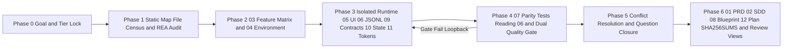

<div align="center">


<br />

[](LICENSE)
[](SKILL.md)
[-3b82f6.svg?style=flat-square)](#생성되는-12종-고정-산출물-0112)
[](#초등학생도-1초-만에-이해하는-mit-대표-예제-3종)
[-0ea5e9.svg?style=flat-square)](#시각동작-실증-명세만으로-클린룸-재구현-검증)

<br />

[English](README.md) · **한국어 (Korean)**

[재구현 실증](#시각동작-실증-명세만으로-클린룸-재구현-검증) · [MIT 대표 예제 3종](#초등학생도-1초-만에-이해하는-mit-대표-예제-3종) · [12종 산출물 맵](#생성되는-12종-고정-산출물-0112) · [기존 스킬 비교](#기존-명세-스킬과의-비교) · [60초 검증](#60초-로컬-검증-명령) · [설치 및 사용법](#설치-및-사용법)

</div>

---

## 정적 코드 읽기만으로 놓치는 지점과 `spec-anything`의 해법

소스 코드만 읽어서는 공식 배포본이 실제로 무엇을 내장해 실행·렌더링하는지 확신할 수 없습니다. `spec-anything`은 **결정론적 정적 추출**, **공식 배포본 REA 감사(`.dmg`/`.app`/npm 번들)**, **격리 실구동 UI·동작 관측**, **실행 가능한 클린룸 차분 대조 테스트**를 하나의 폐루프로 통합합니다.

| 정적 코드 읽기만으로 놓치는 문제 | 일상 MIT 예제 3종에서 `spec-anything`이 실제 검증한 근거 |
| :--- | :--- |
| **배포 번들과 모놀리포 간 괴리** | [`excalidraw/excalidraw v0.18.1`](examples/01-excalidraw-v0.18.1/) 공식 npm 배포본(`dist/prod/index.js`, 65개 ESM export, SHA-512 일치)을 감사하고 `.excalidraw` v2 JSON 왕복 및 라이트·다크 캔버스(`0.18%`–`0.46%` MAE)를 실측 |
| **데스크톱 IPC 변경 및 공증 바이너리 검증** | [`cjpais/Handy v0.10.2`](examples/02-handy-v0.10.2/)(2026년 11월 릴리스) 공증된 macOS `arm64` `.dmg` 및 Mach-O 바이너리에서 **133 / 133** Tauri v2 IPC 커맨드를 전수 대조하고 구버전 제거 커맨드(`change_push_to_talk` → `change_shortcut_activation_setting`) 확인 |
| **바이너리 내장 리소스 및 상태 경계 규칙** | [`Splode/pomotroid v1.7.1`](examples/03-pomotroid-v1.7.1/) 유니버설 macOS Mach-O 내부에 정확히 커밋 SHA `4a02ac7`과 38개 테마가 내장됨을 확인하고, `long_breaks_enabled=false` 시 사이클 리셋 센티널(`work_round_number: 0 → 1`) 및 `MIGRATION_1..6` SQLite WAL 규약을 검증 |

---

## 시각·동작 실증: 명세만으로 클린룸 재구현 검증

포함된 3개 예제 모두 원본 코드와 브랜드 자산을 일절 복제하지 않고 `01`–`12` 명세·계약·UI 토큰만으로 별도 구현한 **실제 동작 클린룸 재구현본**을 포함하며, **수정하지 않은 `07` 대조 테스트**와 Playwright 픽셀 차분 히트맵으로 자동 검증했습니다.


- **손그림 그림판 (`Excalidraw v0.18.1` → `SketchBoard CR`)**: 수정 없는 `07_tests/verify_parity.py --mode reimplementation_diff` **`12 / 12 PASS`**, 도형 캔버스 픽셀 차분 **`0.46%` MAE (`99.54%` 일치)** · 다크 테마 `0.44%` · 빈 캔버스 `0.18%`.
- **2026 최신 음성 받아쓰기 (`Handy v0.10.2` → `Handy CR`)**: Rust/Tauri v2 macOS 앱을 Python + SQLite로 클린룸 재구현, **`15 / 15 PASS`**, 일반 설정 **`1.67%` MAE (`98.33%` 일치)** · 받아쓰기 기록 `2.46%` · 모델 목록 `3.17%`.
- **100% 전체 재구현 공부 타이머 (`Pomotroid v1.7.1` → `PomoCR`)**: Rust/Tauri v2 + Svelte 5 타이머를 Python + SQLite WAL로 전체 종단 재구현, **`14 / 14 PASS`**, 실행 중 원형 다이얼 **`0.83%` MAE (`99.17%` 일치)** · 대기 다크 `0.88%` · 라이트 테마 `0.93%`.
- **대화형 좌우 스와이프 비교기**: 로컬 브라우저에서 [`assets/reimpl-proof-interactive.html`](assets/reimpl-proof-interactive.html)을 열면(한/영 전환 지원) 3개 앱 6개 화면을 슬라이더로 직접 대조할 수 있습니다.

---

## 초등학생도 1초 만에 이해하는 MIT 대표 예제 3종


| # | 예제 경로 | 대상 저장소 (MIT) | Stars | 일상 앱 정체 및 공식 배포본 REA | 자동 검증 결과 |
| :---: | :--- | :--- | :---: | :--- | :--- |
| **01** | [`examples/01-excalidraw-v0.18.1/`](examples/01-excalidraw-v0.18.1/) | [`excalidraw/excalidraw`](https://github.com/excalidraw/excalidraw) `v0.18.1` | 136.3k | **손그림 그림판·화이트보드**: 도형·화살표·글씨·다크 모드·`.excalidraw` v2 JSON 왕복, 공식 npm 배포본 SHA-512 REA + [`cleanroom-reimpl/`](examples/01-excalidraw-v0.18.1/cleanroom-reimpl/) | 원본 `12 / 12` · 클린룸 `12 / 12` (`0.46%` MAE) · 게이트 `13 / 13` |
| **02** | [`examples/02-handy-v0.10.2/`](examples/02-handy-v0.10.2/) | [`cjpais/Handy`](https://github.com/cjpais/Handy) `v0.10.2` *(2026-11)* | 40.3k | **최신 오프라인 음성 받아쓰기 앱**: 공증된 macOS `arm64` `.dmg`(`14.3 MB`) REA, 133/133 Tauri IPC 일치, 결정론적 STT 테스트 대역, SQLite 기록 + [`cleanroom-reimpl/`](examples/02-handy-v0.10.2/cleanroom-reimpl/) | 원본 `15 / 15` · 클린룸 `15 / 15` (`1.67%` MAE) · 게이트 `13 / 13` |
| **03** | [`examples/03-pomotroid-v1.7.1/`](examples/03-pomotroid-v1.7.1/) | [`Splode/pomotroid`](https://github.com/Splode/pomotroid) `v1.7.1` *(2026-05)* | 5.6k | **100% 전체 재구현 원형 공부 타이머**: 유니버설 macOS `.app`(`16.0 MB`) REA, SVG 다이얼, 38개 테마, `MIGRATION_1..6` SQLite WAL, 설정·통계 + [`cleanroom-reimpl/`](examples/03-pomotroid-v1.7.1/cleanroom-reimpl/) | 원본 `14 / 14` · 클린룸 `14 / 14` (`0.83%` MAE) · 게이트 `13 / 13` |

---

## 생성되는 12종 고정 산출물 (`01`–`12`)

모든 분석 대상은 동일한 **12개 고정 산출물 체계**로 생성되며 `Feature ID(F-001)`, `Evidence ID(EV-001)`, `Screen ID(SCR-001)` 외래 키로 전 구간이 연결되고 `SHA256SUMS.txt`와 13개 기계 검증 게이트로 봉인됩니다.


---

## 7단계 폐루프 파이프라인 아키텍처



---

## 기존 명세 스킬과의 비교

[`daishir0/cc-rsg`](https://github.com/daishir0/cc-rsg)의 재개형 상태 머신·다언어 정적 추출·안티매크로 품질 게이트와 [`WindowHyun/Reverse_Spec_and_PRD`](https://github.com/WindowHyun/Reverse_Spec_and_PRD)의 파서 팩트 경계·비밀 마스킹·이중 독자 HTML/PDF/DOCX/SVG 렌더러를 흡수하고, **공식 배포본 REA 감사 + 다상태 UI 실측 + 실행형 클린룸 대조 및 픽셀 차분 검증**을 통합했습니다.

| 기능 항목 | Greenfield SDD (`spec-kit`) | Frontend Reverse Planning (`Reverse_Spec_and_PRD`) | Static Reverse Spec (`cc-rsg`) | `spec-anything` |
| :--- | :---: | :---: | :---: | :---: |
| 결정론적 다언어 정적 추출 + Git 전체 파일 전수 조사 | — | — | ✓ | ✓ |
| 재개 가능한 7단계 상태 머신 (`state.json`) 및 질문 뱅크 | — | — | ✓ | ✓ |
| 비밀 마스킹 및 `file://` SSRF 차단 HTML/PDF/DOCX 리뷰 렌더러 | — | ✓ | — | ✓ |
| 공식 배포본 바이너리·`.dmg`·`.app`·npm 배포본 REA 감사 (`SHA-256`) | — | — | — | ✓ |
| 격리된 실구동 런타임 관측 (`06` JSONL: UI, IPC, HTTP/RPC, SQLite) | — | — | — | ✓ |
| 다상태 UI 기준선 캡처 (`05`) + 실측 CSS 디자인 토큰 (`11`) | — | — | — | ✓ |
| 기계 판독 계약 (`09`: JSON Schema, OpenAPI, SQLite DDL) | — | — | — | ✓ |
| `06` 근거를 직접 읽는 실행형 대조 테스트 (`07`) + 시각 픽셀 차분 | — | — | — | ✓ |

---

## 60초 로컬 검증 명령

저장소를 내려받은 뒤 아래 4개 명령으로 39개 품질 게이트와 비밀 유출 0건을 즉시 재검증할 수 있습니다.

```bash
# 1. Excalidraw v0.18.1 번들 검증 (13/13 게이트 + 48개 체크섬)
python3 scripts/validate_bundle.py examples/01-excalidraw-v0.18.1 --tier T3 --verify-checksums

# 2. Handy v0.10.2 번들 검증 (13/13 게이트 + 45개 체크섬)
python3 scripts/validate_bundle.py examples/02-handy-v0.10.2 --tier T3 --verify-checksums

# 3. Pomotroid v1.7.1 번들 검증 (13/13 게이트 + 43개 체크섬)
python3 scripts/validate_bundle.py examples/03-pomotroid-v1.7.1 --tier T3 --verify-checksums

# 4. 저장소 전체 비밀 유출 검사 (0건 확인)
python3 scripts/secret_guard.py . --fail-on-hit
```

---

## 설치 및 사용법

### Claude Code / Codex CLI / OpenBot 설치

```bash
mkdir -p ~/.claude/skills/spec-anything
cp -r SKILL.md LICENSE schemas scripts agents references templates ~/.claude/skills/spec-anything/
```

**실행 요구 사항**:

- **기본 (`T1`–`T2`)**: Python `3.10+` 표준 라이브러리만으로 상태 관리, 정적 추출, 파일 전수 조사, REA 감사, 비밀 검사 실행 가능.
- **전체 `T3` UI 캡처·픽셀 차분·리뷰 문서 생성**: `pip install jsonschema markdown pillow playwright python-docx && playwright install chromium`.

### 에이전트 호출 예시

```text
spec-anything 스킬로 https://github.com/Splode/pomotroid (태그 v1.7.1, 티어 T3)를 분석해줘.
공식 macOS 배포 바이너리 REA 감사와 격리된 임시 워크스페이스 UI/상태/SQLite 실측을 수행하고,
01–12 산출물, 클린룸 재구현본, 07 대조 테스트 및 validate_bundle.py 통과까지 완료해줘.
```

---

## 포함된 결정론적 자동화 스크립트 (`scripts/`)

<details>
<summary><strong>7개 자동화 스크립트 역할 펼치기</strong></summary>

| 스크립트 | 책임 범위 |
| :--- | :--- |
| `scripts/state_manager.py` | 7단계 재개형 상태 머신 (`.spec-anything/state.json`), `goal.json`, `questions.json` 질문 뱅크 관리 |
| `scripts/source_map.py` | 다언어 정적 구조 추출기 (Go, TS/JS, Svelte, Vue, Python, Rust, SQL, HTML, CSS) 및 미분석 경고 출력 |
| `scripts/file_inventory.py` | Git 커밋 추적 파일 전수 조사 및 `03` 기능 ID·제외 사유 대조 검증 |
| `scripts/inspect_release.py` | 공식 배포본 아카이브·바이너리 REA 감사 (SHA-256, `checksums.txt`, `go version -m`, `otool`, `codesign`) |
| `scripts/secret_guard.py` | API 키, PEM 개인키, 원문 JWT 자동 탐지 및 마스킹 |
| `scripts/validate_bundle.py` | 13개 게이트 이중 기계 검증기 (12종 고정 산출물, `[REF:]`, `## Sources Read`, 매크로 비율, 구조 전용 Mermaid, JSON Schema, 외래 키 정합성, `06->07` 연결, JSON Schema/OpenAPI/SQLite 실행, 비밀, `SHA256SUMS.txt`) |
| `scripts/render_review.py` | PM/Design 및 Dev/QA 이중 독자 단일 HTML, SVG, DOCX, `file://` SSRF 차단 PDF 리뷰 렌더러 |

</details>

---

## 클린룸 범위 및 라이선스

권한이 있는 오픈소스 기능 재구현, 언어 포팅, 상호운용성 검증 목적으로만 사용합니다. 취약점 악용, 접근 제어·DRM 우회, 저작권이 있는 UI 에셋·폰트·상표의 무단 재배포는 범위에 포함하지 않습니다.

**MIT 라이선스**([`LICENSE`](LICENSE))로 배포됩니다.
