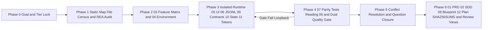

<div align="center">


<br />

[](LICENSE)
[](SKILL.md)
[-3b82f6.svg?style=flat-square)](#what-spec-anything-generates-0112)
[](#three-intuitive-mit-flagship-examples)
[-0ea5e9.svg?style=flat-square)](#visual-proof-clean-room-reimplementation)

<br />

**English** · [한국어 (Korean)](README.ko.md)

[Visual Proof](#visual-proof-clean-room-reimplementation) · [3 Everyday MIT Examples](#three-intuitive-mit-flagship-examples) · [12-Artifact Map](#what-spec-anything-generates-0112) · [Compare](#how-spec-anything-compares) · [Run Locally](#quick-verification-run-in-60-seconds) · [Install](#installation--usage)

</div>

---

## Why Static Code Reading Isn't Enough (and What `spec-anything` Catches Live)

Reading source code alone misses what official releases actually ship and render. `spec-anything` pairs **deterministic source extraction** with **official release REA auditing (`.dmg`/`.app`/npm tarballs)**, **live multi-state UI capture**, and **executable clean-room differential parity tests**:

| What Static Reading Misses | What `spec-anything` Verified Live Across 3 Everyday MIT Apps |
| :--- | :--- |
| **Published bundle vs. monorepo drift** | In [`excalidraw/excalidraw v0.18.1`](examples/01-excalidraw-v0.18.1/), audited the official npm distribution (`dist/prod/index.js`, `65` ESM exports, SHA-512 verified) and captured exact `.excalidraw` v2 JSON roundtrip + light/dark canvas renders (`0.18%`–`0.46%` MAE). |
| **Renamed desktop IPC & notarized binary surface** | In [`cjpais/Handy v0.10.2`](examples/02-handy-v0.10.2/) (released Nov 2026), audited the notarized macOS `arm64` `.dmg` & Mach-O binary, verifying all **`133 / 133`** Tauri v2 IPC commands and catching removed legacy commands (`change_push_to_talk` → `change_shortcut_activation_setting`). |
| **Embedded assets & hidden state sentinels** | In [`Splode/pomotroid v1.7.1`](examples/03-pomotroid-v1.7.1/), proved the universal macOS Mach-O embeds exact commit SHA `4a02ac7` + all 38 themes inside the binary, and caught the `long_breaks_enabled=false` cycle sentinel (`work_round_number: 0 → 1`) plus `MIGRATION_1..6` SQLite WAL rules. |

---

## Visual Proof: Clean-Room Reimplementation

Every included example ships a **real, working clean-room reimplementation** built strictly from `spec-anything`'s `01`–`12` outputs (zero upstream source code or brand marks copied), verified automatically by the **unmodified `07` parity test harnesses** and Playwright pixel-diff heatmaps:


- **Hand-Drawn Whiteboard (`Excalidraw v0.18.1` → `SketchBoard CR`)**: Unmodified `07_tests/verify_parity.py --mode reimplementation_diff` passed **`12 / 12`** with **`0.46%` MAE (`99.54%` visual match)** on shapes, `0.44%` dark mode, and `0.18%` empty canvas.
- **2026 Offline Speech-to-Text (`Handy v0.10.2` → `Handy CR`)**: Rust/Tauri v2 macOS app reimplemented in Python + SQLite; passed **`15 / 15`** with **`1.67%` MAE (`98.33%` visual match)** on General Settings, `2.46%` History, and `3.17%` Models.
- **100% Full-App Circular Study Timer (`Pomotroid v1.7.1` → `PomoCR`)**: Rust/Tauri v2 + Svelte 5 timer reimplemented end-to-end in Python + SQLite WAL; passed **`14 / 14`** with **`0.83%` MAE (`99.17%` visual match)** on running dial, `0.88%` idle dark, and `0.93%` light theme.
- **Interactive Swipe Viewer**: Open [`assets/reimpl-proof-interactive.html`](assets/reimpl-proof-interactive.html) locally in any browser (English / Korean toggle included) to scrub left/right across all 6 original vs. clean-room screens.

---

## Three Intuitive MIT Flagship Examples


| # | Example Directory | Target Repo (MIT) | Stars | Everyday App & Official Release REA | Automated Results |
| :---: | :--- | :--- | :---: | :--- | :--- |
| **01** | [`examples/01-excalidraw-v0.18.1/`](examples/01-excalidraw-v0.18.1/) | [`excalidraw/excalidraw`](https://github.com/excalidraw/excalidraw) `v0.18.1` | 136.3k | **Hand-Drawn Whiteboard**: Shapes, arrows, text, dark mode, `.excalidraw` v2 JSON roundtrip, official npm tarball SHA-512 REA + [`cleanroom-reimpl/`](examples/01-excalidraw-v0.18.1/cleanroom-reimpl/) | `12 / 12` upstream · `12 / 12` clean-room (`0.46%` MAE) · `13 / 13` gates |
| **02** | [`examples/02-handy-v0.10.2/`](examples/02-handy-v0.10.2/) | [`cjpais/Handy`](https://github.com/cjpais/Handy) `v0.10.2` *(Nov 2026)* | 40.3k | **Offline Speech-to-Text Desktop App**: Notarized macOS `arm64` `.dmg` (`14.3 MB`) REA, 133/133 Tauri IPC verified, deterministic STT stub, SQLite history + [`cleanroom-reimpl/`](examples/02-handy-v0.10.2/cleanroom-reimpl/) | `15 / 15` upstream · `15 / 15` clean-room (`1.67%` MAE) · `13 / 13` gates |
| **03** | [`examples/03-pomotroid-v1.7.1/`](examples/03-pomotroid-v1.7.1/) | [`Splode/pomotroid`](https://github.com/Splode/pomotroid) `v1.7.1` *(May 2026)* | 5.6k | **100% Full-App Circular Study Timer**: Universal macOS `.app` (`16.0 MB`) REA, SVG dial, 38 themes, `MIGRATION_1..6` SQLite WAL, Settings & Stats + [`cleanroom-reimpl/`](examples/03-pomotroid-v1.7.1/cleanroom-reimpl/) | `14 / 14` upstream · `14 / 14` clean-room (`0.83%` MAE) · `13 / 13` gates |

---

## What `spec-anything` Generates (`01`–`12`)

Every target produces the same **12 fixed deliverables**, cross-linked by `Feature ID` (`F-001`), `Evidence ID` (`EV-001`), and `Screen ID` (`SCR-001`), sealed with `SHA256SUMS.txt` and validated by 13 mechanical quality gates:


---

## Closed-Loop 7-Phase Pipeline



---

## How `spec-anything` Compares

`spec-anything` combines the operational discipline of [`daishir0/cc-rsg`](https://github.com/daishir0/cc-rsg) (resumable state machine, multi-language static extractor, anti-macro coverage gates) and [`WindowHyun/Reverse_Spec_and_PRD`](https://github.com/WindowHyun/Reverse_Spec_and_PRD) (parser-fact boundary, secret redaction, dual-audience HTML/PDF/DOCX/SVG rendering), and adds **REA official release auditing + live multi-state UI capture + executable clean-room parity & pixel-diff verification**:

| Capability | Greenfield SDD (`spec-kit`) | Frontend Reverse Planning (`Reverse_Spec_and_PRD`) | Static Reverse Spec (`cc-rsg`) | `spec-anything` |
| :--- | :---: | :---: | :---: | :---: |
| Deterministic multi-language static extractor + git file census | — | — | ✓ | ✓ |
| Resumable 7-phase state machine (`state.json`) & Question Bank | — | — | ✓ | ✓ |
| Secret redaction & `file://` SSRF-safe HTML/PDF/DOCX review renderer | — | ✓ | — | ✓ |
| Official release binary / `.dmg` / `.app` / npm tarball REA audit (`SHA-256`) | — | — | — | ✓ |
| Isolated live runtime observation (`06` JSONL: UI, IPC, HTTP/RPC, SQLite) | — | — | — | ✓ |
| Multi-state UI screenshots (`05`) + live computed CSS tokens (`11`) | — | — | — | ✓ |
| Machine-readable contracts (`09`: JSON Schema, OpenAPI, SQLite DDL) | — | — | — | ✓ |
| Executable differential parity tests (`07`) consuming `06` + visual pixel diff | — | — | — | ✓ |

---

## Quick Verification (Run in 60 Seconds)

Clone this repository and verify all 39 quality gates plus zero secret leaks locally:

```bash
# 1. Validate Excalidraw v0.18.1 bundle (13/13 gates + 48 SHA256SUMS)
python3 scripts/validate_bundle.py examples/01-excalidraw-v0.18.1 --tier T3 --verify-checksums

# 2. Validate Handy v0.10.2 bundle (13/13 gates + 45 SHA256SUMS)
python3 scripts/validate_bundle.py examples/02-handy-v0.10.2 --tier T3 --verify-checksums

# 3. Validate Pomotroid v1.7.1 bundle (13/13 gates + 43 SHA256SUMS)
python3 scripts/validate_bundle.py examples/03-pomotroid-v1.7.1 --tier T3 --verify-checksums

# 4. Run Secret Guard across the entire repository (must report 0 hits)
python3 scripts/secret_guard.py . --fail-on-hit
```

---

## Installation & Usage

### Install for Claude Code / Codex CLI / OpenBot

```bash
mkdir -p ~/.claude/skills/spec-anything
cp -r SKILL.md LICENSE schemas scripts agents references templates ~/.claude/skills/spec-anything/
```

**Runtime Requirements**:

- **Core (`T1`–`T2`)**: Python `3.10+` (standard library runs state management, static extraction, file census, REA audit, secret scanning, and core checks).
- **Full `T3` UI Capture, Pixel Diff & Review Views**: `pip install jsonschema markdown pillow playwright python-docx && playwright install chromium`.

### Trigger Example

```text
Use the spec-anything skill on https://github.com/Splode/pomotroid (tag v1.7.1, tier T3).
Audit the official macOS release binary, capture live UI/state/SQLite evidence in an isolated temp workspace,
generate deliverables 01–12, build a clean-room reimplementation, and pass validate_bundle.py + 07 parity tests.
```

---

## Included Scripts (`scripts/`)

<details>
<summary><strong>Click to inspect all 7 deterministic automation scripts</strong></summary>

| Script | Responsibility |
| :--- | :--- |
| `scripts/state_manager.py` | 7-phase resumable state machine (`.spec-anything/state.json`), `goal.json`, and `questions.json` Question Bank |
| `scripts/source_map.py` | Deterministic multi-language extractor (Go, TS/JS, Svelte, Vue, Python, Rust, SQL, HTML, CSS) + Loud Warnings |
| `scripts/file_inventory.py` | Git-commit tracked file census and `03` Feature ID / exclusion disposition verifier |
| `scripts/inspect_release.py` | Official release archive/binary REA auditor (SHA-256, `checksums.txt`, `go version -m`, `otool`, `codesign`, embedded probes) |
| `scripts/secret_guard.py` | Automated secret, API key, PEM private key, and raw JWT scanner/redactor |
| `scripts/validate_bundle.py` | 13-gate mechanical validator (12 deliverables, `[REF:]`, `## Sources Read`, `--max-macro-ratio`, structure-only Mermaid, JSON Schema, FK integrity, `06->07` linkage, JSON Schema/OpenAPI/SQLite execution, secrets, `SHA256SUMS.txt`) |
| `scripts/render_review.py` | Dual-audience PM/Design & Dev/QA single-file HTML, SVG, DOCX, and `file://` SSRF-safe PDF review renderer |

</details>

---

## Clean-Room Scope & License

Strictly intended for authorized open-source functional reimplementation, language porting, and interoperability verification. Excludes exploit development, access-control/DRM bypass, and unauthorized redistribution of copyrighted UI assets, fonts, or brand trademarks.

Released under the **MIT License** ([`LICENSE`](LICENSE)).
