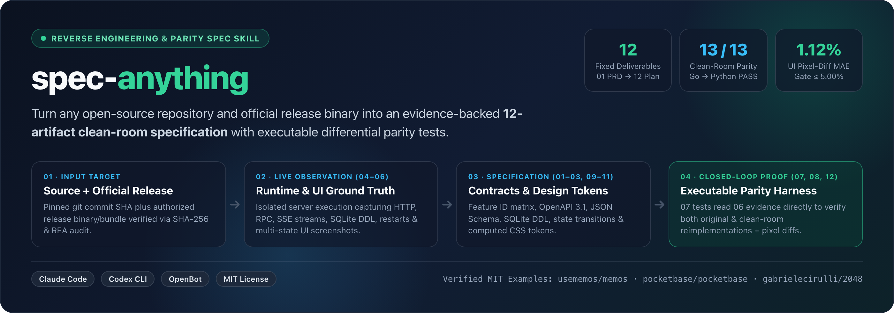
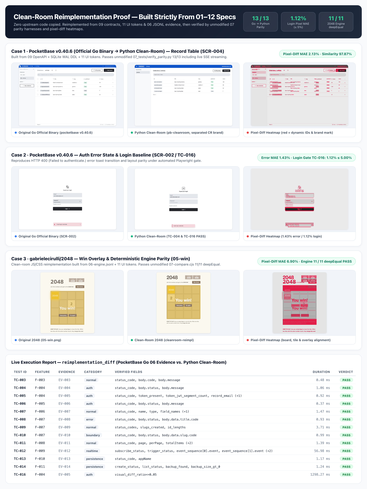
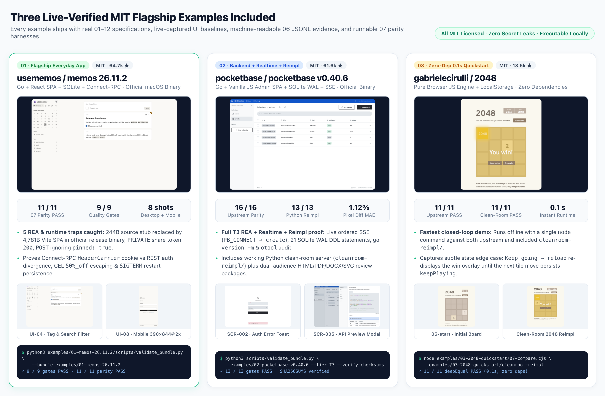
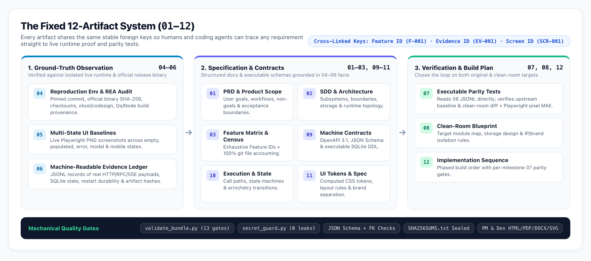
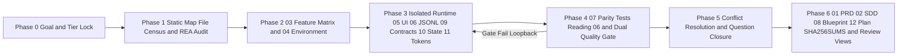

<div align="center">



<br />

[](LICENSE)
[](SKILL.md)
[-3b82f6.svg?style=flat-square)](#what-spec-anything-generates-0112)
[](#visual-proof-clean-room-reimplementation)
[-0ea5e9.svg?style=flat-square)](#visual-proof-clean-room-reimplementation)

<br />

**English** · [한국어 (Korean)](README.ko.md)

[Visual Proof](#visual-proof-clean-room-reimplementation) · [3 Live MIT Examples](#three-live-verified-mit-flagship-examples) · [12-Artifact Map](#what-spec-anything-generates-0112) · [Compare](#how-spec-anything-compares) · [Run Locally](#quick-verification-run-in-60-seconds) · [Install](#installation--usage)

</div>

---

## Why Static Source Reading Fails (and What `spec-anything` Catches)

Reading source code alone misses what actually ships and executes. `spec-anything` pairs **static source extraction** with **official release binary/bundle auditing (REA)**, **isolated live runtime observation**, and **executable differential parity tests**:

| What Static Code Reading Misses | What `spec-anything` Caught Live in Included MIT Examples |
| :--- | :--- |
| **Build-time asset replacement** | In [`usememos/memos 26.11.2`](examples/01-memos-26.11.2/), the repo's `244 B` stub `index.html` is replaced by a `4,781 B` Vite SPA embedded inside the official release binary. |
| **Runtime-only API & auth traps** | Memos returns `200` for a `PRIVATE` memo via share token, ignores `pinned: true` on `POST`, and splits Connect-RPC `HeaderCarrier` cookies from REST auth — all logged in `06` JSONL and guarded by `07` tests. |
| **Framework assumptions & live streaming** | [`pocketbase/pocketbase v0.40.6`](examples/02-pocketbase-v0.40.6/) ships a vanilla-JS Admin SPA (not Svelte) with live ordered SSE (`/api/realtime`) and 21 live SQLite WAL DDL statements verified against `go version -m` & `otool`. |
| **Stateful UI timing edge cases** | [`gabrielecirulli/2048`](examples/03-2048-quickstart/) re-shows the win overlay on `Keep going -> reload` until the next tile move persists `keepPlaying` to `localStorage`. |

---

## Visual Proof: Clean-Room Reimplementation

Every specification claim is backed by **real clean-room reimplementations** written strictly from `spec-anything`'s `01`–`12` outputs (zero upstream code or trademarks copied), verified automatically by the **unmodified `07` parity test harnesses** and Playwright pixel-diff heatmaps:



- **Go Official Binary → Python Clean-Room (`PocketBase v0.40.6`)**: Unmodified `07_tests/verify_parity.py --target-url` passed **`13 / 13`** (`reimplementation_diff` mode — `400`/`200` auth, `401` guard, dynamic DDL, validation & unique error codes, `fexpr` filter/sort, **live ordered SSE `/api/realtime` streaming**, backup zip, and **Playwright login pixel diff `1.12% <= 5.00%`**).
- **Original JS → Clean-Room JS/CSS (`gabrielecirulli/2048`)**: Unmodified `07-compare.cjs` passed **`11 / 11 deepEqual`** across all event sequences, serialization checks, and the `Keep going -> reload` edge case.
- **Interactive Swipe Viewer**: Open [`assets/reimpl-proof-interactive.html`](assets/reimpl-proof-interactive.html) locally in any browser (English / Korean toggle included) to scrub left/right across the original and clean-room UI renders.

---

## Three Live-Verified MIT Flagship Examples



| # | Example Directory | Target Repo (MIT) | Stars | Focus & Verified Highlights | Automated Results |
| :---: | :--- | :--- | :---: | :--- | :--- |
| **01** | [`examples/01-memos-26.11.2/`](examples/01-memos-26.11.2/) | [`usememos/memos`](https://github.com/usememos/memos) `26.11.2` | 64.7k | **Full-Stack Everyday App**: Go + React + SQLite + Connect-RPC, 8 UI baselines (desktop + mobile `390x844@2x`), 5 real REA/runtime traps, `SIGTERM` restart recovery | `11 / 11` parity · `9 / 9` gates · `0` leaks |
| **02** | [`examples/02-pocketbase-v0.40.6/`](examples/02-pocketbase-v0.40.6/) | [`pocketbase/pocketbase`](https://github.com/pocketbase/pocketbase) `v0.40.6` | 61.6k | **Backend + Realtime + Clean-Room Proof**: Go + Vanilla JS SPA + SQLite WAL + SSE `/api/realtime`, 6 UI states, 21 SQLite DDL statements, REA Mach-O + `go version -m`, dual-audience HTML/PDF/DOCX/SVG reviews, plus [`cleanroom-reimpl/`](examples/02-pocketbase-v0.40.6/cleanroom-reimpl/) | `16 / 16` upstream · `13 / 13` reimpl (`1.12%` MAE) · `13 / 13` gates |
| **03** | [`examples/03-2048-quickstart/`](examples/03-2048-quickstart/) | [`gabrielecirulli/2048`](https://github.com/gabrielecirulli/2048) | 13.5k | **Zero-Dependency 0.1s Quickstart**: Pure Node.js closed-loop `06 -> 07` parity demo (`Keep going -> reload` timing), plus [`cleanroom-reimpl/`](examples/03-2048-quickstart/cleanroom-reimpl/) | `11 / 11` upstream · `11 / 11` clean-room (`0.1s`) |

---

## What `spec-anything` Generates (`01`–`12`)

Every target produces the same **12 fixed deliverables**, cross-linked by `Feature ID` (`F-001`), `Evidence ID` (`EV-001`), and `Screen ID` (`SCR-001`), sealed with `SHA256SUMS.txt` and validated by mechanical gates:



---

## Closed-Loop 7-Phase Pipeline



---

## How `spec-anything` Compares

`spec-anything` combines the operational discipline of [`daishir0/cc-rsg`](https://github.com/daishir0/cc-rsg) (resumable state machine, multi-language static extractor, anti-macro coverage gates) and [`WindowHyun/Reverse_Spec_and_PRD`](https://github.com/WindowHyun/Reverse_Spec_and_PRD) (parser-fact boundary, secret redaction, dual-audience HTML/PDF/DOCX/SVG rendering), and adds **REA release auditing + isolated live runtime/UI capture + executable differential parity testing**:

| Capability | Greenfield SDD (`spec-kit`) | Frontend Reverse Planning (`Reverse_Spec_and_PRD`) | Static Reverse Spec (`cc-rsg`) | `spec-anything` |
| :--- | :---: | :---: | :---: | :---: |
| Deterministic multi-language static extractor + git file census | — | — | ✓ | ✓ |
| Resumable 7-phase state machine (`state.json`) & Question Bank | — | — | ✓ | ✓ |
| Secret redaction & `file://` SSRF-safe HTML/PDF/DOCX review renderer | — | ✓ | — | ✓ |
| Official release binary / archive / bundle REA audit (`SHA-256`) | — | — | — | ✓ |
| Isolated live runtime observation (`06` JSONL: HTTP, RPC, SSE, SQLite, Restart) | — | — | — | ✓ |
| Multi-state UI screenshots (`05`) + live computed CSS tokens (`11`) | — | — | — | ✓ |
| Machine-readable contracts (`09`: OpenAPI 3.1, JSON Schema, SQLite DDL) | — | — | — | ✓ |
| Executable differential parity tests (`07`) consuming `06` + visual pixel diff | — | — | — | ✓ |

---

## Quick Verification (Run in 60 Seconds)

Clone or unzip this repository and run all four verification checks directly:

```bash
# 1. Zero-dependency 0.1s Quickstart (2048 original AND clean-room reimplementation)
node examples/03-2048-quickstart/07-compare.cjs examples/03-2048-quickstart/upstream
node examples/03-2048-quickstart/07-compare.cjs examples/03-2048-quickstart/cleanroom-reimpl

# 2. Validate PocketBase flagship bundle across all 13 static + dynamic + SQLite + secret + SHA-256 gates
python3 scripts/validate_bundle.py examples/02-pocketbase-v0.40.6 --tier T3 --verify-checksums

# 3. Validate Memos flagship bundle across all static + dynamic + SQLite DDL + secret gates
python3 examples/01-memos-26.11.2/scripts/validate_bundle.py --bundle examples/01-memos-26.11.2

# 4. Run Secret Guard across the entire repository (must report 0 hits)
python3 scripts/secret_guard.py . --fail-on-hit
```

---

## Installation & Usage

### Install for Claude Code / Codex CLI / OpenBot

```bash
mkdir -p ~/.claude/skills/spec-anything
cp -r SKILL.md LICENSE schemas scripts agents references templates ~/.claude/skills/spec-anything/
```

**Runtime Requirements**:

- **Core (`T1`–`T2`)**: Python `3.10+` (standard library runs `state_manager.py`, `source_map.py`, `file_inventory.py`, `inspect_release.py`, `secret_guard.py`, and core checks).
- **Full `T3` UI Capture & Review Views**: `pip install jsonschema markdown pillow playwright python-docx && playwright install chromium`.

### Trigger Example

```text
Use the spec-anything skill on https://github.com/pocketbase/pocketbase (tag v0.40.6, tier T3).
Audit the official release binary, capture live API/SSE/UI evidence in an isolated temp workspace,
generate deliverables 01–12, and verify everything passes validate_bundle.py and 07 parity tests.
```

---

## Included Scripts (`scripts/`)

<details>
<summary><strong>Click to inspect all 7 deterministic automation scripts</strong></summary>

| Script | Responsibility |
| :--- | :--- |
| `scripts/state_manager.py` | 7-phase resumable state machine (`.spec-anything/state.json`), `goal.json`, and `questions.json` Question Bank |
| `scripts/source_map.py` | Deterministic multi-language extractor (Go, TS/JS, Svelte, Vue, Python, Rust, SQL, HTML, CSS) + Loud Warnings |
| `scripts/file_inventory.py` | Git-commit tracked file census and `03` Feature ID / exclusion disposition verifier |
| `scripts/inspect_release.py` | Official release archive/binary REA auditor (SHA-256, `checksums.txt`, `go version -m`, `otool`, `codesign`, embedded probes) |
| `scripts/secret_guard.py` | Automated secret, API key, PEM private key, and raw JWT scanner/redactor |
| `scripts/validate_bundle.py` | 13-gate mechanical validator (12 deliverables, `[REF:]`, `## Sources Read`, `--max-macro-ratio`, structure-only Mermaid, JSON Schema, FK integrity, `06->07` linkage, OpenAPI/SQLite execution, secrets, `SHA256SUMS.txt`) |
| `scripts/render_review.py` | Dual-audience PM/Design & Dev/QA single-file HTML, SVG, DOCX, and `file://` SSRF-safe PDF review renderer |

</details>

---

## Clean-Room Scope & License

Strictly intended for authorized open-source functional reimplementation, language porting, and interoperability verification. Excludes exploit development, access-control/DRM bypass, and unauthorized redistribution of copyrighted UI assets, fonts, or brand trademarks.

Released under the **MIT License** ([`LICENSE`](LICENSE)).
