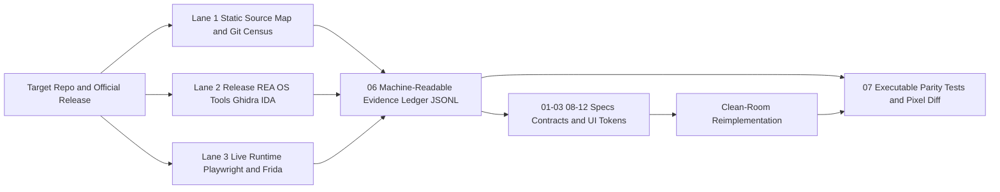
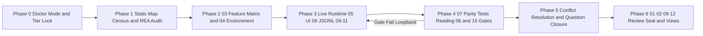

<div align="center">

# spec-anything

**Turn any open-source app into a verified clean-room specification — and prove a rebuild matches the real app.**

[](LICENSE)
[](SKILL.md)
[](#examples)

**English** · [한국어](README.ko.md)

[Examples](#examples) · [How It Works](#how-it-works) · [Quick Start](#quick-start) · [Under the Hood](#under-the-hood-detailed-mechanism)

</div>

---

<table>
  <tr>
    <td width="25%" valign="top">
      <strong>Study real software</strong><br/>
      Inspects source code, official releases (<code>.dmg</code>, <code>.app</code>, npm), and live running screens together.
    </td>
    <td width="25%" valign="top">
      <strong>Clean-Room or Deep</strong><br/>
      Run black-box surface capture (<code>clean-room</code>) or full source, decompiler, and trace analysis (<code>deep</code>).
    </td>
    <td width="25%" valign="top">
      <strong>Checked, not guessed</strong><br/>
      Generates 12 cross-linked specs, RFC 2119 / GIVEN-WHEN-THEN contracts, runnable parity tests, and pixel-diff proofs.
    </td>
    <td width="25%" valign="top">
      <strong>Agent-ready skill</strong><br/>
      10 deterministic scripts and 3 specialist subagents for Claude Code, Codex CLI, OpenBot, Ghidra, IDA, and Frida.
    </td>
  </tr>
</table>

## Examples

Every example below was rebuilt from scratch using only the generated spec — zero original source code or brand marks copied.


| App (MIT) | What It Is | Parity Tests | Visual Match | Bundle |
| :--- | :--- | :---: | :---: | :--- |
| [**Excalidraw**](https://github.com/excalidraw/excalidraw) `v0.18.1` | Hand-drawn whiteboard | `12 / 12` | `99.5%` (`0.46%` MAE) | [Spec](examples/01-excalidraw-v0.18.1/) · [Rebuild](examples/01-excalidraw-v0.18.1/cleanroom-reimpl/) |
| [**Handy**](https://github.com/cjpais/Handy) `v0.10.2` *(2026)* | Offline speech-to-text | `15 / 15` | `98.3%` (`1.67%` MAE) | [Spec](examples/02-handy-v0.10.2/) · [Rebuild](examples/02-handy-v0.10.2/cleanroom-reimpl/) |
| [**Pomotroid**](https://github.com/Splode/pomotroid) `v1.7.1` | Circular study timer | `14 / 14` | `99.2%` (`0.83%` MAE) | [Spec](examples/03-pomotroid-v1.7.1/) · [Rebuild](examples/03-pomotroid-v1.7.1/cleanroom-reimpl/) |

> Open [`assets/reimpl-proof-interactive.html`](assets/reimpl-proof-interactive.html) locally in any browser to compare all 6 screens with a slider (EN / KO).

## How It Works

1. **Inspect code & official release** — Reads pinned source code and audits the shipped binary or package (`.dmg`, `.app`, ELF/PE, or npm tarball).
2. **Run the app live** — Launches the app in an isolated workspace to capture multi-state screenshots, measured CSS tokens, schemas, and observed state transitions.
3. **Generate 12 specs & parity tests** — Outputs fixed deliverables (`01`–`12`) and executable tests that check both the original app and any clean-room rebuild.

### Clean-Room vs. Deep Mode

- **`clean-room` (black-box)**: Observes only public UI, measured layout/CSS tokens, and external I/O without reading proprietary source internals.
- **`deep` (authorized open-source / owned targets)**: Unlocks full source extraction, official release REA auditing, headless **Ghidra** / **IDA** decompilation, and read-only **Frida** dynamic tracing.

## Quick Start

### 1. Install the skill (Claude Code · Codex CLI · OpenBot)

```bash
mkdir -p ~/.claude/skills/spec-anything
cp -r SKILL.md LICENSE schemas scripts agents references templates ~/.claude/skills/spec-anything/
```

Requires Python `3.10+`. For UI screenshots, pixel diffs, and PDF/DOCX review exports, install:

```bash
pip install jsonschema markdown pillow playwright python-docx && playwright install chromium
```

### 2. Check installed engines & run from your agent

```bash
python3 scripts/doctor.py
```

```text
Use the spec-anything skill on https://github.com/Splode/pomotroid (v1.7.1, mode deep, tier T3)
to generate deliverables 01–12, build a clean-room reimplementation, and pass all parity tests.
```

### 3. Verify all 3 included examples locally (45/45 gates + offline self-tests)

```bash
for ex in examples/*; do python3 scripts/validate_bundle.py "$ex" --tier T3 --verify-checksums; done
python3 scripts/validate_bundle.py --self-test
python3 scripts/spec_diff.py --self-test
python3 scripts/frida_trace_bridge.py self-test
python3 scripts/secret_guard.py --self-test && python3 scripts/secret_guard.py . --fail-on-hit --scan-injections
```

---

## Under the Hood: Detailed Mechanism

Everything below documents the complete internal pipeline, reverse-engineering backends, governance & safety controls, specialist subagents, and validation gates.

### 1. Four-Layer Triangulation Engine

Reading source code alone misses what official releases actually package, compile, and render. `spec-anything` triangulates across four deterministic lanes — uniting static source maps, release binary auditing, live runtime observation, and closed-loop parity testing:



| Analysis Layer | What It Inspects | Tools & Optional Backends |
| :--- | :--- | :--- |
| **1. Static Source & Drift** | Multi-language AST/symbol maps, parser-fact boundary (`facts.md`), 100% git tracked file census, and upstream commit-to-feature change impact | `scripts/source_map.py`, `scripts/file_inventory.py`, `scripts/spec_diff.py` |
| **2. Official Release REA & Decompilation** | Archive/binary SHA-256 & upstream checksums, Mach-O/ELF slices, code signatures, exported symbols, embedded runtime probes; optional headless decompilation, xrefs, call targets, and local types | `scripts/inspect_release.py`, OS native tools (`otool`, `lipo`, `nm`, `codesign`, `readelf`), headless **Ghidra** (`analyzeHeadless` / `pyghidra-mcp` / `rea-ghidra`), **IDA Pro 9.4+** (`idat` / `idalib` / `HexRaysSA/ida-mcp` / `mrexodia/ida-pro-mcp`) |
| **3. Isolated Runtime & Dynamic Tracing** | Multi-state UI screenshots, `getComputedStyle` design tokens, HTTP/IPC/SQLite WAL state mutations, restart persistence; optional read-only runtime function/IPC tracing (`ITR2` binary & JSONL) | Headless Playwright, SQLite3, read-only **Frida** observers via `scripts/frida_trace_bridge.py` (`sqlite`, `objc-storage`, `posix-io`, `ipc`, `frida-itrace`) |
| **4. Closed-Loop Parity & Visual Proof** | Unmodified `07` test harnesses consuming `06_evidence/ledger.jsonl` directly — passing on the live upstream app first, then diffing any clean-room rebuild + Playwright pixel MAE | `07_tests/verify_parity.py`, `scripts/validate_bundle.py`, `scripts/render_review.py` |

See [`references/adapters/re-backends.md`](references/adapters/re-backends.md) for backend setup commands, MCP contracts, and non-bypass safety rules.

### 2. Governance, Safety & State-Integrity Controls

To prevent AI over-claiming, silent stale-evidence reuse, race corruption, and untrusted-input prompt injection, `spec-anything` enforces six deterministic controls:

| Control | What It Enforces | Implementation |
| :--- | :--- | :--- |
| **Machine-Ceiling Downgrade-Only Gate & Anti-Slop** | Computes deterministic `grade_ceiling` (`A`–`F`) and `can_claim_full_coverage` from observed ratio, failures, and degraded tools — AI verdicts may only maintain or downgrade, never exceed the ceiling; rejects `N/A`/`TODO`/`TBD`/`none`/`-`/empty payloads | `scripts/validate_bundle.py` (`GOV1`, optional exit `42` via `--strict-ceiling`), `schemas/parity_report.schema.json` |
| **Untrusted-Evidence Prompt-Injection Guard** | Enforces a fixed `SECURITY CONTRACT` preamble on evidence snapshots and scans 4 categories (`instruction_override`, `identity_hijack`, `tool_call_forgery`, `exfiltration_channel`) as non-blocking `[AI-Safety]` advisories | `scripts/secret_guard.py --scan-injections`, `SKILL.md`, `references/adapters/re-backends.md` |
| **3-Axis Bijective Tool Coverage Accounting** | Tracks every analyzer across `applicability × installation × execution` + `evidence_quality`, requires non-primary tools to appear in exactly one of `missing_tools` or `must_rerun_tools`, and separates `terminal_state_completion_rate` from `primary_tool_success_rate` | `scripts/doctor.py --emit-coverage`, `schemas/tool_coverage.schema.json`, `scripts/validate_bundle.py` (`GOV2`) |
| **Tamper- & Race-Safe State Machine + Epoch Isolation** | Uses atomic `temp + fsync + os.replace` writes, POSIX `fcntl.flock` session locks (`session_busy`), target-digest Epoch reset (`lineage_base_revision`), deterministic `cache_key`, retry budget (`max=3`), `reopen_events`, and append-only `RUN_MANIFEST.jsonl` | `scripts/state_manager.py`, `schemas/state.schema.json` |
| **3-Tier Secret Confidence Classifier** | Classifies secret detections into `info` (name only), `low` (short/placeholder), and `high` (prefix tokens, Bearer ≥20 chars, or ≥16 chars with ≥2 character classes), blocking gates only on `high` leaks | `scripts/secret_guard.py` (`SEC1`, `--min-confidence`) |
| **RFC 2119 Scenarios, Non-Scope & Defect Non-Inheritance** | Expresses acceptance criteria in RFC 2119 (`MUST`/`SHALL`/`SHOULD`/`MAY`) + `GIVEN-WHEN-THEN` scenarios, separates "Specified Contract vs. Reimplementer Discretion", documents upstream accidental defects not to inherit, and grades features `must` / `should` / `optional` | `references/deliverables-01-12.md`, `schemas/feature_matrix.schema.json` |

### 3. Fixed 12-Artifact System (`01`–`12`), Specialist Subagents & 7-Phase Pipeline

Every target produces the same **12 fixed deliverables**, cross-linked by `Feature ID` (`F-001`), `Evidence ID` (`EV-001`), and `Screen ID` (`SCR-001`), tagged with a 5-state honesty enum (`observed`, `code-verified`, `inferred`, `assumed`, `unverified`), sealed with `SHA256SUMS.txt`, and checked by **15 mechanical quality gates**:




- **Specialist Subagents (`agents/`)**: Parallel domain investigation via [`agents/slice-investigator.md`](agents/slice-investigator.md), independent read-only compliance verification via [`agents/spec-reviewer.md`](agents/spec-reviewer.md), and read-only upstream diff impact triage via [`agents/impact-analyst.md`](agents/impact-analyst.md).
- **Closed-Loop Oracle Rule (`06 → 07`)**: `07` parity tests read inputs, preconditions, and expected outputs directly from `06_evidence/ledger.jsonl` — verified against the live upstream app first, then against any clean-room rebuild.
- **English Machine Layer + Multi-Language Narrative**: Schema keys, IDs (`F-001`, `EV-001`, `SCR-001`), `[REF: path:start-end]` citations, and literal `## Sources Read` headings stay English forever so automated validators remain deterministic, while prose renders in English, Korean, or Japanese.

### 4. What Static Code Reading Misses: Verified Live REA Findings

| Gap Missed by Static Reading Alone | Verified Live Across the 3 Included MIT Examples |
| :--- | :--- |
| **Published package vs. monorepo drift** | In [`Excalidraw v0.18.1`](examples/01-excalidraw-v0.18.1/), audited the official npm tarball (`dist/prod/index.js`, `65` ESM exports, SHA-512 verified) and captured `.excalidraw` v2 JSON roundtrip + light/dark canvas renders (`0.18%`–`0.46%` MAE). |
| **Renamed desktop IPC & notarized binary surface** | In [`Handy v0.10.2`](examples/02-handy-v0.10.2/) *(Nov 2026)*, audited the notarized macOS `arm64` `.dmg` (`14.3 MB`) and Mach-O binary, verifying all **`133 / 133`** Tauri v2 IPC commands and confirming legacy command removal (`change_push_to_talk` → `change_shortcut_activation_setting`). |
| **Embedded binary assets & hidden state sentinels** | In [`Pomotroid v1.7.1`](examples/03-pomotroid-v1.7.1/), proved the universal macOS Mach-O (`x86_64 + arm64`, `16.0 MB`) embeds exact commit SHA `4a02ac7` + all 38 themes inside the binary, and verified the `long_breaks_enabled=false` cycle sentinel (`work_round_number: 0 → 1`) plus `MIGRATION_1..6` SQLite WAL rules. |

### 5. Deterministic Automation Scripts (`scripts/`)

| Script | Responsibility |
| :--- | :--- |
| [`scripts/doctor.py`](scripts/doctor.py) | Preflight readiness checker across core CLI tools, Playwright/PIL, OS native binary tools, Ghidra, IDA (`idalib`/`ida-hcli`), and Frida + 3-axis bijective `tool_coverage.json` emitter |
| [`scripts/state_manager.py`](scripts/state_manager.py) | Atomic `temp+os.replace` + POSIX `flock` 7-phase state machine, `--mode clean-room` / `--mode deep`, target-digest Epoch reset, retry budget, and append-only `RUN_MANIFEST.jsonl` |
| [`scripts/source_map.py`](scripts/source_map.py) | Multi-language static extractor (Go, TS/JS, Svelte, Vue, Python, Rust, SQL, HTML, CSS) with Loud Warnings and `facts.md` output |
| [`scripts/file_inventory.py`](scripts/file_inventory.py) | Git-commit tracked file census and `03` Feature ID / exclusion disposition verifier |
| [`scripts/spec_diff.py`](scripts/spec_diff.py) | Deterministic upstream change-impact and spec-vs-code sync analyzer mapping changed files or `git diff` ranges to impacted `F-XXX` / `EV-XXX` / `SCR-XXX` / `TC-XXX` IDs |
| [`scripts/inspect_release.py`](scripts/inspect_release.py) | Official release archive/binary REA auditor (SHA-256, `checksums.txt`, `lipo`, `otool`, `nm`, `readelf`, `codesign`, `go version -m`, custom `--probe`, Ghidra/IDA backend detection) |
| [`scripts/frida_trace_bridge.py`](scripts/frida_trace_bridge.py) | Authorized read-only Frida Gum hook generator (`sqlite`, `objc-storage`, `posix-io`, `ipc`), JSONL & `frida-itrace` (`ITR2`) parser into `06_evidence/ledger.jsonl`, offline `self-test` |
| [`scripts/secret_guard.py`](scripts/secret_guard.py) | 3-tier (`high`/`low`/`info`) secret confidence classifier + 4-category `[AI-Safety]` untrusted prompt-injection detector (`--fail-on-hit`, `--scan-injections`, `--self-test`) |
| [`scripts/validate_bundle.py`](scripts/validate_bundle.py) | 15-gate mechanical & governance validator (12 deliverables, `[REF:]`, `## Sources Read`, macro ratio, structure-only Mermaid, JSON Schema, FK integrity, `06→07` linkage, OpenAPI/Schema/SQLite execution, 3-tier secrets, Machine Ceiling & Anti-Slop, 3-axis bijective coverage, `SHA256SUMS.txt`, `--strict-ceiling` exit `42`) |
| [`scripts/render_review.py`](scripts/render_review.py) | Dual-audience PM/Design & Dev/QA single-file HTML, SVG, DOCX, and `file://` SSRF-safe PDF review renderer |

### 6. Ecosystem Comparison & Related Projects

| Capability | Greenfield SDD (`spec-kit` / `OpenSpec` / `sdd-tool`) | Frontend Reverse (`Reverse_Spec_and_PRD`) | Static Reverse (`cc-rsg`) | Clean-Room Engine (`craft-anything`) | Core RE (`Ghidra` / `IDA` / `Frida`) | `spec-anything` |
| :--- | :---: | :---: | :---: | :---: | :---: | :---: |
| Fixed 12-artifact clean-room PRD/SDD/Blueprint taxonomy (`01`–`12`) | — | — | — | — | — | ✓ |
| RFC 2119 + GIVEN-WHEN-THEN contracts, impact sync & read-only review subagents | ✓ | — | — | — | — | ✓ |
| Deterministic multi-language static map & git file census | — | — | ✓ | ✓ | — | ✓ |
| Secret redaction & `file://` SSRF-safe dual-audience review renderer | — | ✓ | — | — | — | ✓ |
| Clean-Room vs. Deep boundary & 3-axis `doctor` coverage | — | — | — | ✓ | — | ✓ |
| Native binary decompilation & dynamic runtime tracing integration | — | — | — | ✓ | ✓ | ✓ |
| Machine-readable `06` JSONL ledger directly consumed by `07` parity tests | — | — | — | — | — | ✓ |
| 15-gate validator (Machine Ceiling, Anti-Slop, Prompt-Injection, `SHA256SUMS`) | — | — | ✓ | — | — | ✓ |

**Related & Inspired Open-Source Projects**:
- **Spec-Driven & Reverse-Planning**: [`github/spec-kit`](https://github.com/github/spec-kit) · [`Fission-AI/OpenSpec`](https://github.com/Fission-AI/OpenSpec) · [`JakeB-5/sdd-tool`](https://github.com/JakeB-5/sdd-tool) · [`daishir0/cc-rsg`](https://github.com/daishir0/cc-rsg) · [`WindowHyun/Reverse_Spec_and_PRD`](https://github.com/WindowHyun/Reverse_Spec_and_PRD)
- **Clean-Room & Reverse-Engineering Engines**: [`storytold/craft-anything`](https://github.com/storytold/craft-anything) · [`NationalSecurityAgency/ghidra`](https://github.com/NationalSecurityAgency/ghidra) ([`pyghidra-mcp`](https://github.com/clearbluejar/pyghidra-mcp)) · [`HexRaysSA/ida-mcp`](https://github.com/HexRaysSA/ida-mcp) ([`mrexodia/ida-pro-mcp`](https://github.com/mrexodia/ida-pro-mcp)) · [`frida/frida`](https://github.com/frida/frida) ([`frida-tools`](https://github.com/frida/frida-tools))

### 7. Clean-Room Policy, References & License

- **Authorized Scope Only**: Strictly intended for authorized open-source functional reimplementation, language porting, and interoperability verification. Explicitly prohibits vulnerability exploitation, access-control/DRM/anti-cheat bypass, memory patching, and unauthorized redistribution of copyrighted UI assets, fonts, or brand trademarks.
- **Additional Docs**: [`SKILL.md`](SKILL.md) · [`references/adapters/re-backends.md`](references/adapters/re-backends.md) · [`docs/ARCHITECTURE.md`](docs/ARCHITECTURE.md)
- **License**: Released under the **[MIT License](LICENSE)**.
