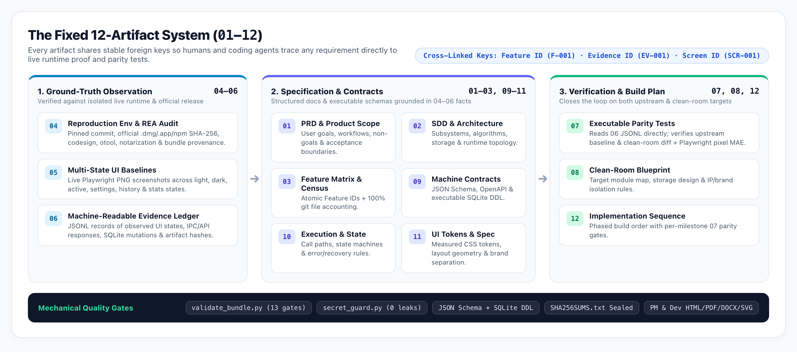
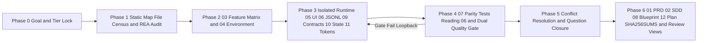
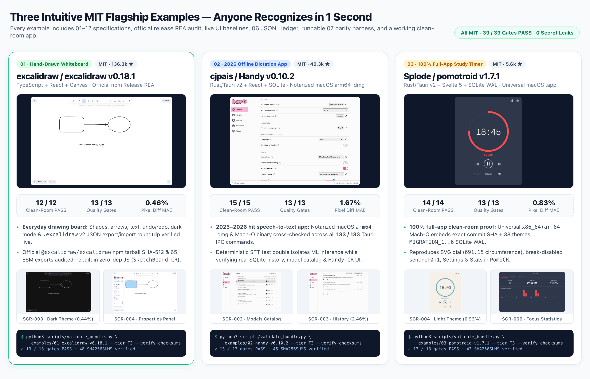

# 아키텍처·배포본 감사 근거 및 스크립트 안내

[← README로 돌아가기](../README.ko.md) · [English](ARCHITECTURE.md)

이 문서는 `spec-anything`의 전체 7단계 파이프라인, 공식 배포본(REA) 실측 발견 사례, 12종 산출물 도식, 생태계 상세 비교, 자동화 스크립트 명세를 담고 있습니다.

---

## 정적 코드 읽기만으로 놓치는 지점 (실제 REA 검증 사례)

소스 코드만 읽어서는 공식 배포본이 실제로 무엇을 포함해 실행·렌더링하는지 확신할 수 없습니다. 포함된 MIT 대표 예제 3종에서 실구동 관측과 공식 배포본 감사를 통해 확인한 근거는 다음과 같습니다.

| 정적 코드 읽기만으로 놓치는 문제 | 일상 MIT 예제 3종에서 `spec-anything`이 실제 검증한 근거 |
| :--- | :--- |
| **배포 번들과 모놀리포 간 괴리** | [`excalidraw/excalidraw v0.18.1`](../examples/01-excalidraw-v0.18.1/) 공식 npm 배포본(`dist/prod/index.js`, 65개 ESM export, SHA-512 일치)을 감사하고 `.excalidraw` v2 JSON 왕복 및 라이트·다크 캔버스(`0.18%`–`0.46%` MAE)를 실측 |
| **데스크톱 IPC 변경 및 공증 바이너리 검증** | [`cjpais/Handy v0.10.2`](../examples/02-handy-v0.10.2/)(2026년 11월 릴리스) 공증된 macOS `arm64` `.dmg`(`14.3 MB`) 및 Mach-O 바이너리(`com.pais.handy`)에서 **133 / 133** Tauri v2 IPC 커맨드를 전수 대조하고 구버전 제거 커맨드(`change_push_to_talk` → `change_shortcut_activation_setting`) 확인 |
| **바이너리 내장 리소스 및 상태 경계 규칙** | [`Splode/pomotroid v1.7.1`](../examples/03-pomotroid-v1.7.1/) 유니버설 macOS Mach-O(`x86_64 + arm64`, `16.0 MB`) 내부에 정확히 커밋 SHA `4a02ac7`과 38개 테마가 내장됨을 확인하고, `long_breaks_enabled=false` 시 사이클 리셋 센티널(`work_round_number: 0 → 1`) 및 `MIGRATION_1..6` SQLite WAL 규약을 검증 |

---

## 생성되는 12종 고정 산출물 (`01`–`12`)

모든 분석 대상은 동일한 12개 고정 산출물 체계로 생성되며 `Feature ID(F-001)`, `Evidence ID(EV-001)`, `Screen ID(SCR-001)` 외래 키로 전 구간이 연결되고 `SHA256SUMS.txt`와 13개 기계 검증 게이트로 봉인됩니다.

---

## 7단계 폐루프 파이프라인

---

## MIT 대표 예제 3종 상세 검증 내역

| # | 예제 경로 | 대상 저장소 (MIT) | Stars | 공식 배포본 REA 실측 근거 | 자동 검증 결과 |
| :---: | :--- | :--- | :---: | :--- | :--- |
| **01** | [`examples/01-excalidraw-v0.18.1/`](../examples/01-excalidraw-v0.18.1/) | [`excalidraw/excalidraw`](https://github.com/excalidraw/excalidraw) `v0.18.1` | 136.3k | 공식 npm 배포본 `@excalidraw/excalidraw@0.18.1` (SHA-512 일치, 65개 ESM export) | 원본 `12 / 12` · 클린룸 `12 / 12` (`0.46%` MAE) · 게이트 `13 / 13` (체크섬 48건) |
| **02** | [`examples/02-handy-v0.10.2/`](../examples/02-handy-v0.10.2/) | [`cjpais/Handy`](https://github.com/cjpais/Handy) `v0.10.2` *(2026-11)* | 40.3k | 공증된 macOS `arm64` `.dmg`(`14.3 MB`), `133 / 133` Tauri v2 IPC 대조, 결정론적 STT 테스트 대역 | 원본 `15 / 15` · 클린룸 `15 / 15` (`1.67%` MAE) · 게이트 `13 / 13` (체크섬 45건) |
| **03** | [`examples/03-pomotroid-v1.7.1/`](../examples/03-pomotroid-v1.7.1/) | [`Splode/pomotroid`](https://github.com/Splode/pomotroid) `v1.7.1` *(2026-05)* | 5.6k | 유니버설 macOS `.app`(`16.0 MB`), 내장 SHA·38개 테마, `MIGRATION_1..6` SQLite WAL | 원본 `14 / 14` · 전체 클린룸 `14 / 14` (`0.83%` MAE) · 게이트 `13 / 13` (체크섬 43건) |

---

## 기존 명세 스킬과의 상세 비교

[`daishir0/cc-rsg`](https://github.com/daishir0/cc-rsg)의 재개형 상태 머신·다언어 정적 추출·안티매크로 품질 게이트와 [`WindowHyun/Reverse_Spec_and_PRD`](https://github.com/WindowHyun/Reverse_Spec_and_PRD)의 파서 팩트 경계·비밀 마스킹·이중 독자 HTML/PDF/DOCX/SVG 렌더러를 흡수하고, **공식 배포본 REA 감사 + 다상태 UI 실측 + 실행형 클린룸 대조 및 픽셀 차분 검증**을 통합했습니다.

| 기능 항목 | Greenfield SDD (`spec-kit`) | Frontend Reverse Planning (`Reverse_Spec_and_PRD`) | Static Reverse Spec (`cc-rsg`) | `spec-anything` |
| :--- | :---: | :---: | :---: | :---: |
| 결정론적 다언어 정적 추출 + Git 전체 파일 전수 조사 | — | — | ✓ | ✓ |
| 재개 가능한 7단계 상태 머신 (`state.json`) 및 질문 뱅크 | — | — | ✓ | ✓ |
| 비밀 마스킹 및 `file://` SSRF 차단 HTML/PDF/DOCX 리뷰 렌더러 | — | ✓ | — | ✓ |
| 공식 배포본 바이너리·`.dmg`·`.app`·npm 배포본 REA 감사 (`SHA-256`) | — | — | — | ✓ |
| 격리된 실구동 런타임 관측 (`06` JSONL: UI, IPC, HTTP/RPC, SQLite) | — | — | — | ✓ |
| 다상태 UI 기준선 캡처 (`05`) + 실측 CSS 디자인 토큰 (`11`) | — | — | — | ✓ |
| 기계 판독 계약 (`09`: JSON Schema, OpenAPI, SQLite DDL) | — | — | — | ✓ |
| `06` 근거를 직접 읽는 실행형 대조 테스트 (`07`) + 시각 픽셀 차분 | — | — | — | ✓ |

---

## 포함된 결정론적 자동화 스크립트 10종 (`scripts/`)

| 스크립트 | 책임 범위 |
| :--- | :--- |
| [`scripts/doctor.py`](../scripts/doctor.py) | 핵심 CLI, Playwright·PIL, OS 네이티브 바이너리 도구, Ghidra, IDA(`idalib`/`ida-hcli`), Frida 사전 진단 + 3축 전단사 `tool_coverage.json` 생성 |
| [`scripts/state_manager.py`](../scripts/state_manager.py) | `temp+os.replace` 원자적 커밋 + POSIX `flock` 7단계 상태 머신, `--mode clean-room` / `--mode deep`, 타깃 해시 Epoch 초기화, 재시도 예산, 추가 전용 `RUN_MANIFEST.jsonl` |
| [`scripts/source_map.py`](../scripts/source_map.py) | 다언어 정적 구조 추출기 (Go, TS/JS, Svelte, Vue, Python, Rust, SQL, HTML, CSS) 및 미분석 경고 출력 |
| [`scripts/file_inventory.py`](../scripts/file_inventory.py) | Git 커밋 추적 파일 전수 조사 및 `03` 기능 ID·제외 사유 대조 검증 |
| [`scripts/spec_diff.py`](../scripts/spec_diff.py) | 업스트림 변경 파일·`git diff` 범위를 `03_scope/features.json`의 `source_refs`와 대조해 영향 받는 `F-XXX`·`EV-XXX`·`SCR-XXX`·`TC-XXX` 산출 |
| [`scripts/inspect_release.py`](../scripts/inspect_release.py) | 공식 배포본 아카이브·바이너리 REA 감사 (SHA-256, `checksums.txt`, `lipo`, `otool`, `nm`, `readelf`, `codesign`, `go version -m`, `--probe`, Ghidra·IDA 백엔드 감지) |
| [`scripts/frida_trace_bridge.py`](../scripts/frida_trace_bridge.py) | 권한 있는 읽기 전용 Frida Gum 훅 생성기(`sqlite`, `objc-storage`, `posix-io`, `ipc`), JSONL·`frida-itrace`(`ITR2`) 파싱 후 `06_evidence/ledger.jsonl` 적재, 오프라인 `self-test` |
| [`scripts/secret_guard.py`](../scripts/secret_guard.py) | 3단계(`high`/`low`/`info`) 시크릿 신뢰도 분류기 + 4범주 `[AI-Safety]` 프롬프트 주입 탐지기 |
| [`scripts/validate_bundle.py`](../scripts/validate_bundle.py) | 15개 기계·거버넌스 검증기 (12종 고정 산출물, `[REF:]`, `## Sources Read`, 매크로 비율, 구조 전용 Mermaid, JSON Schema, 외래 키, `06->07` 연결, 계약 실행, 3단계 시크릿, 기계 상한·안티-슬롭, 3축 전단사 커버리지, `SHA256SUMS.txt`, `--strict-ceiling` 종료 `42`) |
| [`scripts/render_review.py`](../scripts/render_review.py) | PM/Design 및 Dev/QA 이중 독자 단일 HTML, SVG, DOCX, `file://` SSRF 차단 PDF 리뷰 렌더러 |

백엔드별 상세 규약(`craft-anything` 모드, Ghidra, IDA, Frida)은 [`references/adapters/re-backends.md`](../references/adapters/re-backends.md)를 참고하십시오.
