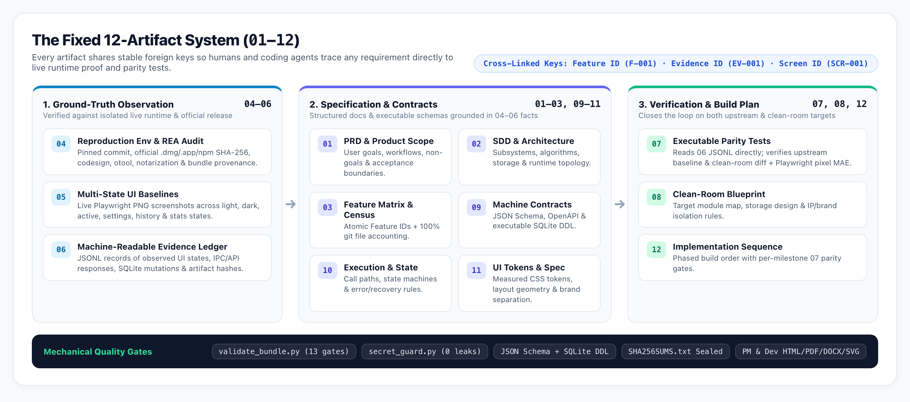
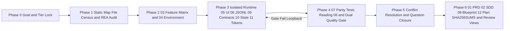
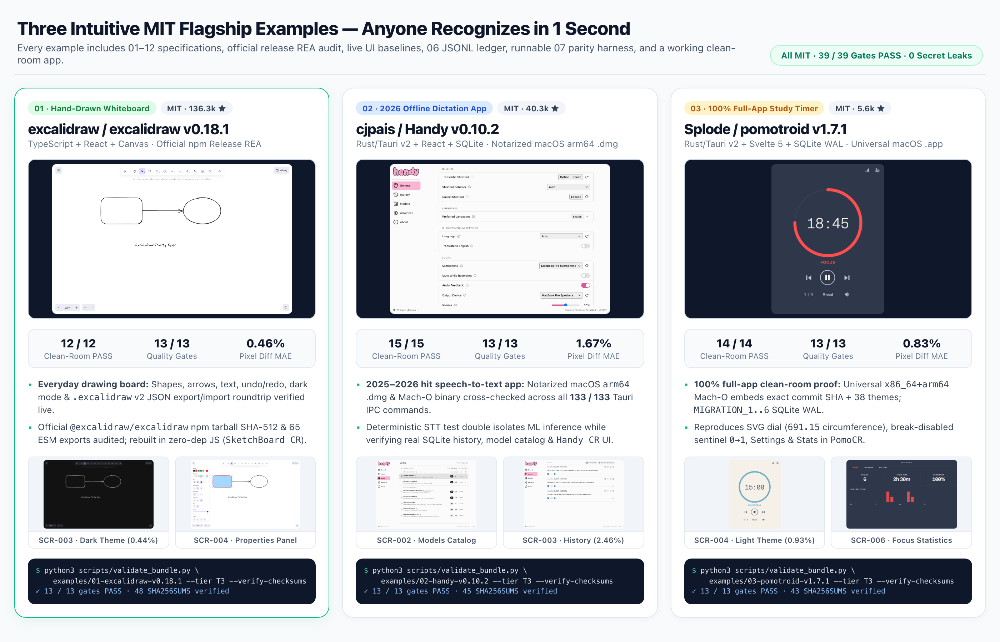

# Architecture, REA Findings & Reference

[← Back to README](../README.md) · [한국어 (Korean)](ARCHITECTURE.ko.md)

This document holds the full technical architecture, official release audit (REA) discoveries, 12-artifact diagram, ecosystem comparison, and automation script reference behind `spec-anything`.

---

## What Static Code Reading Misses (Concrete REA Discoveries)

Reading source code alone cannot confirm what official releases actually ship, embed, or render. Across the 3 included MIT flagship apps, live runtime observation + REA auditing verified:

| Gap in Static Code Reading | Verified Live in `spec-anything` Examples |
| :--- | :--- |
| **Published package vs. monorepo drift** | In [`excalidraw/excalidraw v0.18.1`](../examples/01-excalidraw-v0.18.1/), audited the official npm tarball (`dist/prod/index.js`, `65` ESM exports, SHA-512 verified) and captured exact `.excalidraw` v2 JSON roundtrip plus light/dark canvas renders (`0.18%`–`0.46%` MAE). |
| **Renamed desktop IPC & notarized binary surface** | In [`cjpais/Handy v0.10.2`](../examples/02-handy-v0.10.2/) (released Nov 2026), audited the Apple-notarized macOS `arm64` `.dmg` (`14.3 MB`) and Mach-O binary (`com.pais.handy`), cross-checking all **`133 / 133`** Tauri v2 IPC commands and confirming legacy command removal (`change_push_to_talk` → `change_shortcut_activation_setting`). |
| **Embedded assets & hidden state sentinels** | In [`Splode/pomotroid v1.7.1`](../examples/03-pomotroid-v1.7.1/), proved the universal macOS Mach-O (`x86_64 + arm64`, `16.0 MB`) embeds exact commit SHA `4a02ac7` plus all 38 themes inside the binary, and verified the `long_breaks_enabled=false` cycle sentinel (`work_round_number: 0 → 1`) and `MIGRATION_1..6` SQLite WAL rules. |

---

## The Fixed 12-Artifact System (`01`–`12`)

Every target produces the same 12 deliverables, cross-linked by `Feature ID` (`F-001`), `Evidence ID` (`EV-001`), and `Screen ID` (`SCR-001`), sealed with `SHA256SUMS.txt` and validated by 13 mechanical quality gates:

---

## Closed-Loop 7-Phase Pipeline

---

## Detailed Flagship Examples Breakdown

| # | Example Directory | Target Repo (MIT) | Stars | Official Release REA Provenance | Automated Verification |
| :---: | :--- | :--- | :---: | :--- | :--- |
| **01** | [`examples/01-excalidraw-v0.18.1/`](../examples/01-excalidraw-v0.18.1/) | [`excalidraw/excalidraw`](https://github.com/excalidraw/excalidraw) `v0.18.1` | 136.3k | Official npm tarball `@excalidraw/excalidraw@0.18.1` (SHA-512 verified, 65 ESM exports) | `12 / 12` upstream · `12 / 12` clean-room (`0.46%` MAE) · `13 / 13` gates (48 checksums) |
| **02** | [`examples/02-handy-v0.10.2/`](../examples/02-handy-v0.10.2/) | [`cjpais/Handy`](https://github.com/cjpais/Handy) `v0.10.2` *(Nov 2026)* | 40.3k | Notarized macOS `arm64` `.dmg` (`14.3 MB`), `133 / 133` Tauri v2 IPC audited, deterministic STT stub | `15 / 15` upstream · `15 / 15` clean-room (`1.67%` MAE) · `13 / 13` gates (45 checksums) |
| **03** | [`examples/03-pomotroid-v1.7.1/`](../examples/03-pomotroid-v1.7.1/) | [`Splode/pomotroid`](https://github.com/Splode/pomotroid) `v1.7.1` *(May 2026)* | 5.6k | Universal macOS `.app` (`16.0 MB`), embedded SHA + 38 themes, `MIGRATION_1..6` SQLite WAL | `14 / 14` upstream · `14 / 14` full-app clean-room (`0.83%` MAE) · `13 / 13` gates (43 checksums) |

---

## Full Ecosystem Comparison

`spec-anything` combines the operational rigor of [`daishir0/cc-rsg`](https://github.com/daishir0/cc-rsg) (resumable state machine, multi-language static extractor, anti-macro coverage gates) and [`WindowHyun/Reverse_Spec_and_PRD`](https://github.com/WindowHyun/Reverse_Spec_and_PRD) (parser-fact boundary, secret redaction, dual-audience HTML/PDF/DOCX/SVG rendering), and adds **official release REA auditing + live multi-state UI capture + executable clean-room parity & pixel-diff verification**:

| Capability | Greenfield SDD (`spec-kit`) | Frontend Reverse Planning (`Reverse_Spec_and_PRD`) | Static Reverse Spec (`cc-rsg`) | `spec-anything` |
| :--- | :---: | :---: | :---: | :---: |
| Deterministic multi-language static extractor + git file census | — | — | ✓ | ✓ |
| Resumable 7-phase state machine (`state.json`) & Question Bank | — | — | ✓ | ✓ |
| Secret redaction & `file://` SSRF-safe HTML/PDF/DOCX review renderer | — | ✓ | — | ✓ |
| Official release binary / `.dmg` / `.app` / npm tarball REA audit (`SHA-256`) | — | — | — | ✓ |
| Isolated live runtime observation (`06` JSONL: UI, IPC, HTTP/RPC, SQLite) | — | — | — | ✓ |
| Multi-state UI screenshots (`05`) + live computed CSS tokens (`11`) | — | — | — | ✓ |
| Machine-readable contracts (`09`: JSON Schema, OpenAPI, SQLite DDL) | — | — | — | ✓ |
| Executable differential parity tests (`07`) consuming `06` + visual pixel diff | — | — | — | ✓ |

---

## Included Automation Scripts (`scripts/`)

| Script | Responsibility |
| :--- | :--- |
| [`scripts/doctor.py`](../scripts/doctor.py) | Preflight readiness checker across core CLI tools, Playwright/PIL, OS native binary tools, Ghidra, IDA (`idalib`/`ida-hcli`), and Frida + 3-axis bijective `tool_coverage.json` emitter |
| [`scripts/state_manager.py`](../scripts/state_manager.py) | Atomic `temp+os.replace` + POSIX `flock` 7-phase state machine, `--mode clean-room` / `--mode deep`, target-digest Epoch reset, retry budget, and append-only `RUN_MANIFEST.jsonl` |
| [`scripts/source_map.py`](../scripts/source_map.py) | Deterministic multi-language extractor (Go, TS/JS, Svelte, Vue, Python, Rust, SQL, HTML, CSS) + Loud Warnings |
| [`scripts/file_inventory.py`](../scripts/file_inventory.py) | Git-commit tracked file census and `03` Feature ID / exclusion disposition verifier |
| [`scripts/spec_diff.py`](../scripts/spec_diff.py) | Deterministic upstream change-impact and spec-vs-code sync analyzer mapping changed files or `git diff` ranges to impacted `F-XXX` / `EV-XXX` / `SCR-XXX` / `TC-XXX` IDs |
| [`scripts/inspect_release.py`](../scripts/inspect_release.py) | Official release archive/binary REA auditor (SHA-256, `checksums.txt`, `lipo`, `otool`, `nm`, `readelf`, `codesign`, `go version -m`, custom `--probe`, Ghidra/IDA backend detection) |
| [`scripts/frida_trace_bridge.py`](../scripts/frida_trace_bridge.py) | Authorized read-only Frida Gum hook generator (`sqlite`, `objc-storage`, `posix-io`, `ipc`), JSONL & `frida-itrace` (`ITR2`) parser into `06_evidence/ledger.jsonl`, offline `self-test` |
| [`scripts/secret_guard.py`](../scripts/secret_guard.py) | 3-tier (`high`/`low`/`info`) secret confidence classifier + 4-category `[AI-Safety]` untrusted prompt-injection detector |
| [`scripts/validate_bundle.py`](../scripts/validate_bundle.py) | 15-gate mechanical & governance validator (12 deliverables, `[REF:]`, `## Sources Read`, `--max-macro-ratio`, structure-only Mermaid, JSON Schema, FK integrity, `06->07` linkage, OpenAPI/Schema/SQLite execution, 3-tier secrets, Machine Ceiling & Anti-Slop, 3-axis bijective coverage, `SHA256SUMS.txt`, `--strict-ceiling` exit `42`) |
| [`scripts/render_review.py`](../scripts/render_review.py) | Dual-audience PM/Design & Dev/QA single-file HTML, SVG, DOCX, and `file://` SSRF-safe PDF review renderer |

For detailed backend protocols (`craft-anything` modes, Ghidra, IDA, Frida), see [`references/adapters/re-backends.md`](../references/adapters/re-backends.md).
