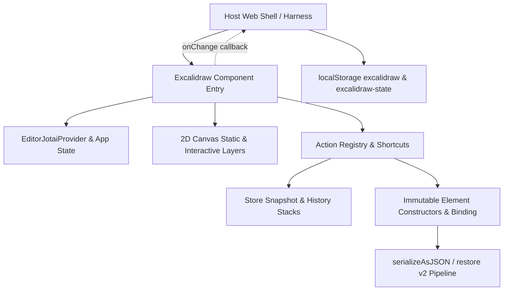

# 02 — Software Design Document (SDD): Excalidraw v0.18.1

## 1. System Architecture Overview
Excalidraw v0.18.1 is structured as a TypeScript monorepo separating the reusable embeddable canvas component (`packages/excalidraw`, published to npm as `@excalidraw/excalidraw`) from the hosted web shell (`excalidraw-app`) and internal geometry/export packages (`packages/math`, `packages/utils`) [REF: packages/excalidraw/package.json:1-123] [REF: scripts/buildPackage.js:1-80].

## 2. Core Subsystem Designs

### 2.1 Component Entry & Public API Surface
- `ExcalidrawBase` wraps `<App />` inside `<EditorJotaiProvider>` and `<InitializeApp>` and exposes the imperative `ExcalidrawImperativeAPI` handle via the `excalidrawAPI` callback prop (`getSceneElements`, `getAppState`, `getFiles`, `updateScene`, `setActiveTool`) [REF: packages/excalidraw/index.tsx:22-151] [REF: packages/excalidraw/components/App.tsx:715-745].
- The official ESM production bundle (`dist/prod/index.js`, `502,077` bytes, 65 named exports) bundles `@excalidraw/math` and `@excalidraw/utils` internally via `esbuild 0.19.10` while keeping `roughjs`, `jotai`, `open-color`, `fractional-indexing`, and `perfect-freehand` as external dependencies [REF: scripts/buildPackage.js:15-65] [REF: packages/excalidraw/package.json:61-93].

### 2.2 Scene Element Data Model
- Every canvas primitive extends `_ExcalidrawElementBase` containing identity (`id`), geometry (`x`, `y`, `width`, `height`, `angle`), styling (`strokeColor`, `backgroundColor`, `fillStyle`, `strokeWidth`, `strokeStyle`, `roughness`, `opacity`, `roundness`), deterministic rendering seed (`seed`), optimistic concurrency metadata (`version`, `versionNonce`, `updated`, `index`), soft-deletion (`isDeleted`), and relational links (`groupIds`, `frameId`, `boundElements`) [REF: packages/excalidraw/element/types.ts:38-80].
- Discriminated union variants specialize linear elements (`points`, `startBinding`, `endBinding`, `startArrowhead`, `endArrowhead`, `elbowed`) and text elements (`text`, `originalText`, `fontSize`, `fontFamily`, `textAlign`, `verticalAlign`, `containerId`, `autoResize`, `lineHeight`) [REF: packages/excalidraw/element/types.ts:232-332].
- Elements are constructed via `_newElementBase` with default props (`DEFAULT_ELEMENT_PROPS`) and mutated immutably with monotonically incremented `version` [REF: packages/excalidraw/element/newElement.ts:77-163].

### 2.3 Store Snapshot & Undo/Redo History Architecture
- `Store` maintains a canonical `Snapshot` and accepts three capture policies via `CaptureUpdateAction`: `IMMEDIATELY` (recorded onto undo stack), `EVENTUALLY` (deferred until next immediate commit), and `NEVER` (updates snapshot without recording history, used for remote sync and initialization) [REF: packages/excalidraw/store.ts:40-73].
- `History` subscribes to `Store.onStoreIncrementEmitter`, pushes inverted `HistoryEntry` deltas onto `undoStack`, clears `redoStack` only when `elementsChange` is non-empty (preserving redo across pure selection clicks), and emits `HistoryChangedEvent` for UI button disabled states [REF: packages/excalidraw/history.ts:16-158].

### 2.4 Theme & Canvas Inversion Design
- Theme variables live under `.excalidraw` (light defaults) and `.excalidraw.theme--dark` (dark overrides) in `packages/excalidraw/css/theme.scss` [REF: packages/excalidraw/css/theme.scss:4-268].
- Rather than rewriting persisted hex colors when toggling dark mode, Excalidraw applies `filter: invert(93%) hue-rotate(180deg)` (`--theme-filter`) to the 2D canvas element while switching UI chrome surfaces to `#232329` over `#121212` canvas background [REF: packages/excalidraw/constants.ts:271-272] [REF: packages/excalidraw/css/theme.scss:172-206].

### 2.5 Serialization & Host Persistence Boundary
- `serializeAsJSON(elements, appState, files, "local")` strips ephemeral UI fields according to `APP_STATE_STORAGE_CONF[key].export` (retaining `viewBackgroundColor`, `gridSize`, `gridStep`, `gridModeEnabled`), filters deleted files, and emits `version: 2` JSON [REF: packages/excalidraw/data/json.ts:43-69] [REF: packages/excalidraw/appState.ts:130-247].
- `restore()` repairs missing defaults, normalizes dimensions (`getNormalizedDimensions`), and repairs arrow bindings (`repairBinding`) [REF: packages/excalidraw/data/restore.ts:111-223].
- Host browser persistence (`localStorage` keys `"excalidraw"` and `"excalidraw-state"`) is implemented in `excalidraw-app/data/localStorage.ts` and is intentionally decoupled from the published npm library (`REA-002`) [REF: excalidraw-app/app_constants.ts:38-51] [REF: excalidraw-app/data/localStorage.ts:36-73].

## Sources Read
- `packages/excalidraw/index.tsx` (lines 1-250)
- `packages/excalidraw/package.json` (lines 1-123)
- `scripts/buildPackage.js` (lines 1-80)
- `packages/excalidraw/element/types.ts` (lines 1-412)
- `packages/excalidraw/element/newElement.ts` (lines 1-250)
- `packages/excalidraw/store.ts` (lines 1-200)
- `packages/excalidraw/history.ts` (lines 1-200)
- `packages/excalidraw/appState.ts` (lines 1-250)
- `packages/excalidraw/data/json.ts` (lines 1-156)
- `packages/excalidraw/data/restore.ts` (lines 1-250)
- `packages/excalidraw/css/theme.scss` (lines 1-268)
- `packages/excalidraw/constants.ts` (lines 1-467)
- `excalidraw-app/app_constants.ts` (lines 1-59)
- `excalidraw-app/data/localStorage.ts` (lines 1-99)
