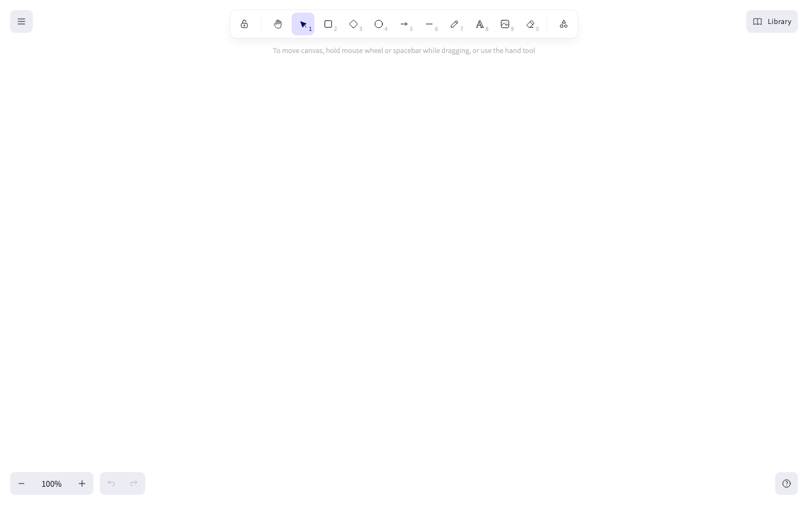
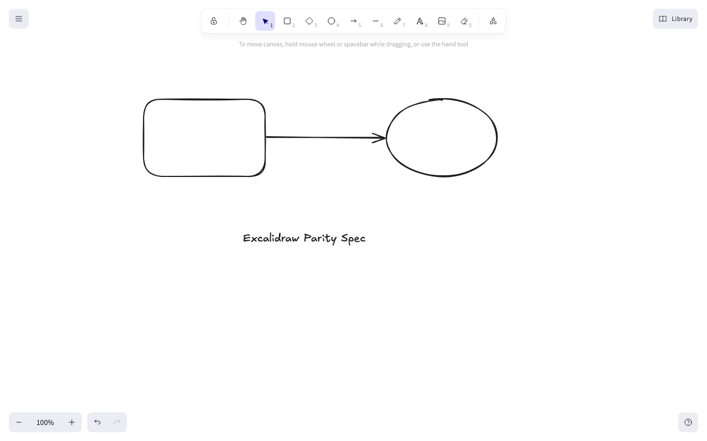
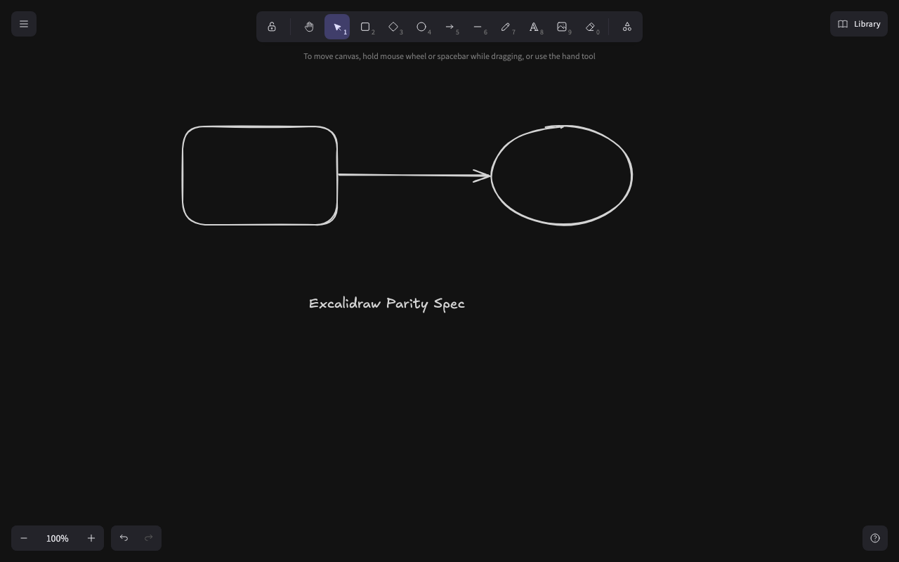
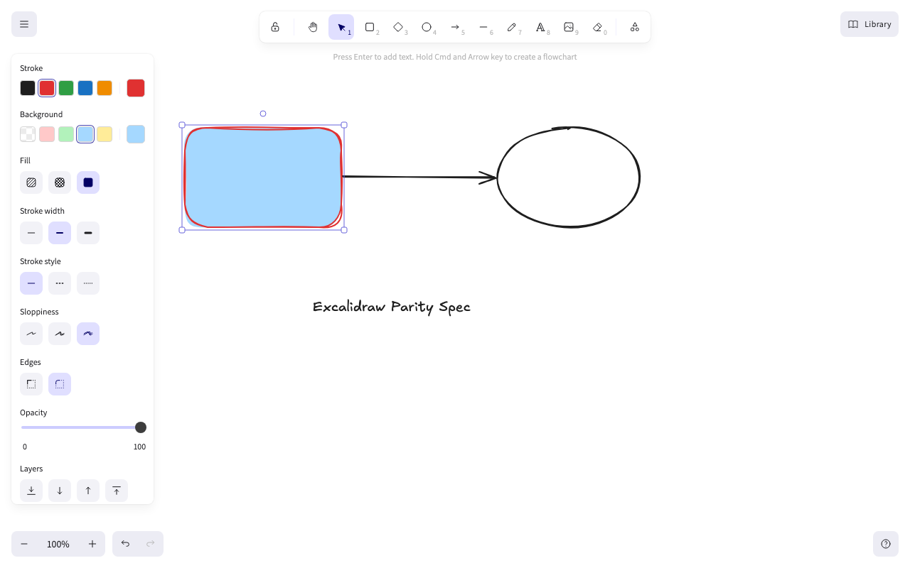
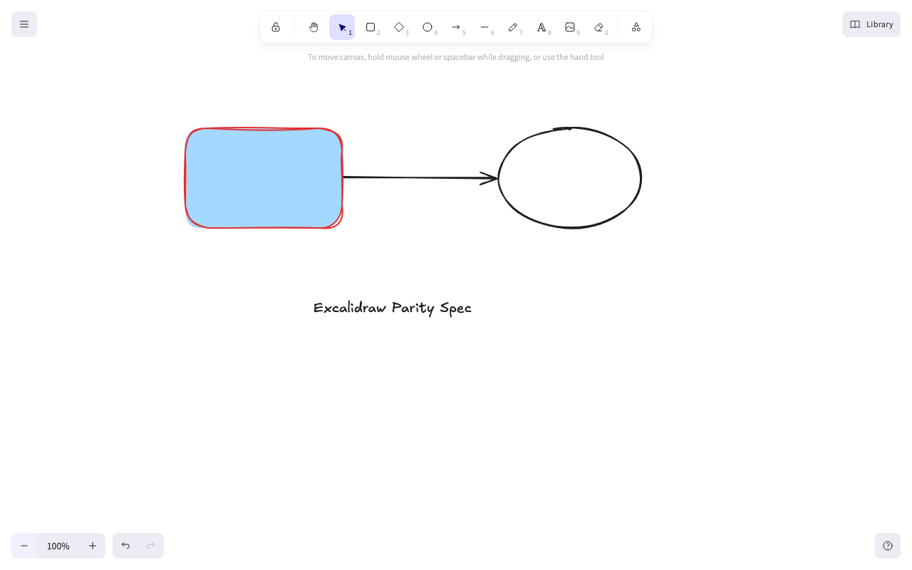

# 05 — Multi-State UI Reference (`SCR-001` .. `SCR-005`)

Machine-readable manifest: `05_ui/screens.json`.
All captures were taken against the live `@excalidraw/excalidraw@0.18.1` production build in headless Chromium at `1280x800`, `device_scale_factor = 1`, after `document.fonts.ready`.

| Screen ID | File | Theme | Linked Features | Linked Evidence | Key Visual State |
| :--- | :--- | :--- | :--- | :--- | :--- |
| `SCR-001` | `05_ui/screenshots/SCR-001_canvas_empty_light.png` | `light` | `F-001`, `F-009` | `EV-001`, `EV-009` | Initial empty `#ffffff` canvas with top-center toolbar (`550x44` at `x=365, y=16`), top-left menu (`36x36` at `x=16, y=16`), top-right trigger (`82x36`), bottom-left zoom (`132x36`) + undo/redo (`72x36`), bottom-right help (`36x36`). |
| `SCR-002` | `05_ui/screenshots/SCR-002_shapes_drawn_light.png` | `light` | `F-002`, `F-003`, `F-004`, `F-005` | `EV-002`, `EV-003`, `EV-004`, `EV-005` | 4-element scene drawn via real pointer drag & text input: rounded rectangle `(260,180,220x140)`, ellipse `(700,180,200x140)`, bound arrow `(482,250 -> 696,250)`, and text `"Excalidraw Parity Spec"` at `(440,420)`. |
| `SCR-003` | `05_ui/screenshots/SCR-003_dark_theme.png` | `dark` | `F-008` | `EV-008` | Identical 4-element scene under `.theme--dark` (`#121212` viewport, `#232329` floating islands, `#403e6a` active tool highlight, canvas `filter: invert(93%) hue-rotate(180deg)`). |
| `SCR-004` | `05_ui/screenshots/SCR-004_selection_properties.png` | `light` | `F-006`, `F-007` | `EV-006`, `EV-007` | Rectangle selected via canvas edge click, showing blue selection frame + handles and left properties inspector (`200x634` at `x=16, y=76`) with `strokeColor: #e03131`, `backgroundColor: #a5d8ff`, `roughness: 2`. |
| `SCR-005` | `05_ui/screenshots/SCR-005_export_roundtrip.png` | `light` | `F-010`, `F-011` | `EV-010`, `EV-011` | Scene serialized via `serializeAsJSON` (v2), cleared to `0` elements, restored via `restore()` + `updateScene()`, and verified intact after page reload from `localStorage`. |

## Visual Gallery
- `SCR-001`: 
- `SCR-002`: 
- `SCR-003`: 
- `SCR-004`: 
- `SCR-005`: 
