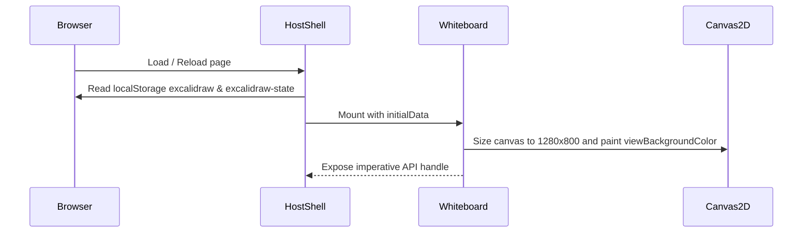
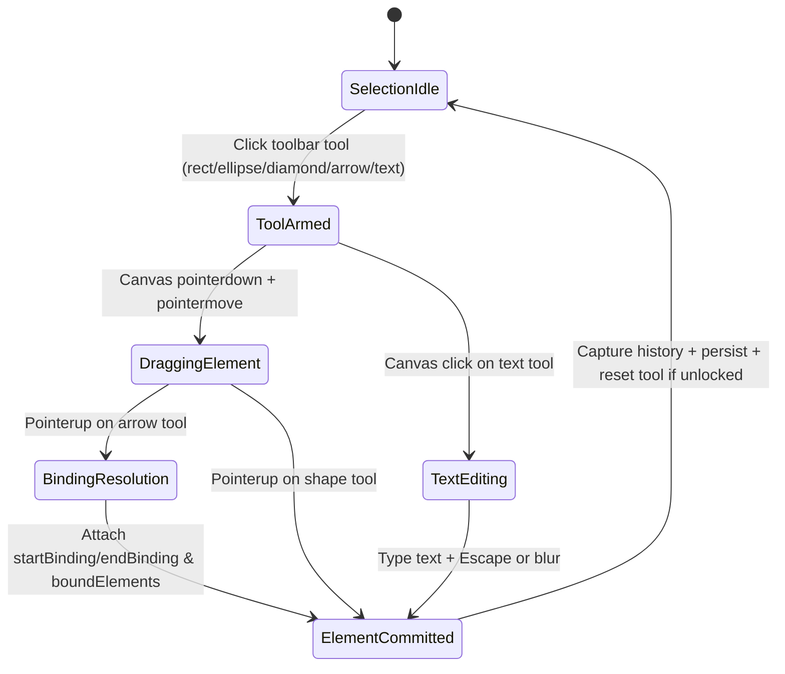
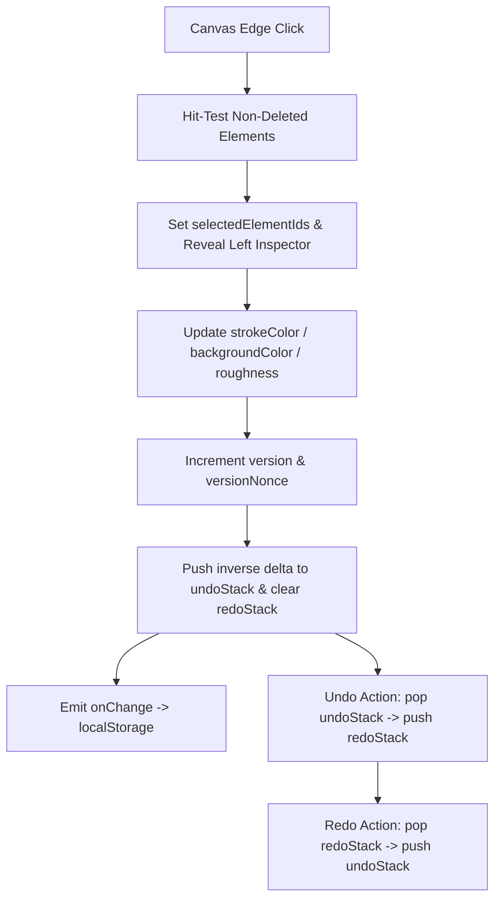

# 10 — Execution Flows & State Transitions

All diagrams follow the structure-only Mermaid contract (no hardcoded color styling).

## 1. Boot & LocalStorage Hydration Flow (`F-001`, `F-011`) {#boot-state}
On page initialization, the host shell checks `localStorage["excalidraw"]` and `localStorage["excalidraw-state"]` before mounting the canvas component (`initialData`), establishing the initial scene state [REF: excalidraw-app/data/localStorage.ts:36-73] [REF: packages/excalidraw/appState.ts:20-124].

## 2. Drawing Primitive, Arrow Binding & Text Commit Lifecycle (`F-002`..`F-005`) {#drawing-lifecycle}
Selecting any creation tool transitions `activeTool.type` out of `"selection"`; completing a pointer drag or committing inline text records an `IMMEDIATELY` captured history increment, persists via `onChange`, and resets `activeTool.type` back to `"selection"` when `locked == false` [REF: packages/excalidraw/components/App.tsx:4676-4710] [REF: packages/excalidraw/element/binding.ts:120-150].

## 3. Selection, Inspector Property Mutation & Undo/Redo Stack (`F-006`, `F-007`) {#history-stack}
Mutating selected element properties or adding/deleting elements records a reversible `HistoryEntry` on `undoStack` and clears `redoStack` whenever element data changes [REF: packages/excalidraw/history.ts:40-134] [REF: packages/excalidraw/actions/actionProperties.tsx:128-149].

## 4. Theme Toggle, Zoom & v2 Serialization Roundtrip (`F-008`, `F-009`, `F-010`) {#serialization-roundtrip}
- **Theme Switch (`#theme-toggle`)**: Toggling `appState.theme` between `"light"` and `"dark"` adds/removes `.theme--dark` on the root node, switching CSS variables (`--default-bg-color`, `--island-bg-color`, `--theme-filter`) without altering element hex values [REF: packages/excalidraw/css/theme.scss:166-268].
- **Viewport Zoom (`#viewport-zoom`)**: Zoom-in and zoom-out step `zoom.value` by `±0.1` via `getStateForZoom`, adjusting `scrollX`/`scrollY` so viewport center remains stationary [REF: packages/excalidraw/scene/zoom.ts:3-35].
- **Export / Restore (`#serialization-roundtrip`)**: `serializeAsJSON` filters deleted elements and non-export appState fields; `restore` validates and normalizes elements before `updateScene` re-renders and re-persists (`#persistence-reload`) [REF: packages/excalidraw/data/json.ts:43-69] [REF: packages/excalidraw/data/restore.ts:145-223].

## 5. Distribution Boundary (`#distribution-boundary`)
- Upstream source monorepo (`packages/excalidraw` + `packages/math` + `packages/utils`) compiles via `scripts/buildPackage.js` into `@excalidraw/excalidraw@0.18.1` (`dist/prod/index.js`), whereas `excalidraw-app/` remains host-specific [REF: scripts/buildPackage.js:1-80].

## Sources Read
- `packages/excalidraw/appState.ts` (lines 20-247)
- `packages/excalidraw/components/App.tsx` (lines 4676-4710, 6329-6390)
- `packages/excalidraw/element/binding.ts` (lines 120-150)
- `packages/excalidraw/actions/actionProperties.tsx` (lines 128-149)
- `packages/excalidraw/history.ts` (lines 16-158)
- `packages/excalidraw/scene/zoom.ts` (lines 3-35)
- `packages/excalidraw/data/json.ts` (lines 43-123)
- `packages/excalidraw/data/restore.ts` (lines 145-223)
- `packages/excalidraw/css/theme.scss` (lines 166-268)
- `excalidraw-app/data/localStorage.ts` (lines 36-73)
- `scripts/buildPackage.js` (lines 1-80)
