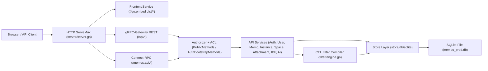

# 02. SDD — `usememos/memos` 26.11.2 소프트웨어 설계 문서 v1.0.0

- **기준 릴리스**: `usememos/memos` `26.11.2` (`00fcd170281a75fc0e95ec4f2f54f43d32fe81bd`, MIT)
- **정적 인벤토리 기준**: `.spec-anything/source-map.json` (845개 파일 스캔, 1,612개 구조 단위 추출: 8개 RPC 서비스, 92개 RPC 메서드, 92개 HTTP 바인딩, 259개 Proto 메시지, 15개 React 라우트)

---

## 1. 시스템 아키텍처 및 배포본 구조 (REA 통합 분석)

`memos` 26.11.2는 단일 Go 바이너리 안에 **HTTP/Connect-RPC/gRPC-Gateway 백엔드**, **순수 Go SQLite 드라이버(`CGO_ENABLED=0`)**, **빌드 타임 `//go:embed` React 19 SPA 번들**을 일체화한 단일 프로세스 아키텍처입니다 (`[REF: server/server.go:1-120]`, `[REF: server/frontend/frontend.go:17-60]`).

### 1.1 공식 배포본 대 소스 삼각 검증(REA) 핵심 발견 `[observed]`
1. **컴파일된 프론트엔드 주입과 `vcs.modified=true`**: 소스 아카이브의 `server/frontend/dist/index.html`은 244바이트 플레이스홀더(`No embeddable frontend found.`)입니다. 반면 CI 릴리스 워크플로우는 `pnpm release`로 Vite 8 React 번들을 `server/frontend/dist`에 빌드한 뒤 `go build`를 수행하므로, 공식 `darwin_arm64` 바이너리는 `vcs.revision=00fcd170281a75fc0e95ec4f2f54f43d32fe81bd`와 일치하면서도 `vcs.modified=true`(`+dirty`)를 기록합니다 (`[REF: .github/workflows/release.yml:84-142]`, `06_evidence/rea_distribution_summary_v1.0.0.json`).
2. **완전 정적형 순수 Go 바이너리**: `go1.27.4`, `CGO_ENABLED=0`, `-tags=netgo,osusergo`, `-trimpath=true`, `-ldflags="-s -w"`로 빌드되어 심볼 테이블(`go tool nm`)이 0개로 스트립되며, macOS 시스템 라이브러리 4종(`libSystem.B.dylib`, `libresolv.9.dylib`, `CoreFoundation`, `Security`)에만 동적 링크합니다 (`EV-001`, `REA-04`).
3. **서명 상태**: 공식 macOS 바이너리는 Apple 공증 서명이 아닌 `adhoc` 링커 서명(`Identifier=a.out`, `TeamIdentifier=not set`) 상태입니다.

---

## 2. API 트랜스포트 및 인증·인가 보안 설계 (`F-003`, `F-005`, `F-009`)

1. **단일 진실 원천 ACL (`server/api/acl_config.go`) `[code-verified]` `[observed]`**
   - `PublicMethods` 맵이 Connect 인터셉터와 gRPC-Gateway 미들웨어 양쪽의 공통 공개 화이트리스트 역할을 합니다 (`[REF: server/api/acl_config.go:11-48]`).
   - gRPC-Gateway 미들웨어는 요청 경로를 프로토콜 HTTP 바인딩 기반 `gatewayRouteResolver`로 선해석해 인가 검사를 선행 적용하며, 모든 API 응답에 `Cache-Control: no-store` 헤더를 강제해 권한이 철회된 메모가 브라우저·프록시 캐시에 잔존하지 못하게 차단합니다 (`[REF: server/api/api.go:95-145]`).
   - `AuthBootstrapMethods`는 인스턴스가 `PRIVATE` 모드일 때도 로그인·토큰 갱신·인스턴스 프로필·공유 링크(`GetSharedMemo`)만 최소 허용합니다 (`[REF: server/api/acl_config.go:63-80]`).
2. **이중 토큰 세션 모델 및 트랜스포트별 쿠키 차이 (`F-005`) `[observed]`**
   - 단기 `accessToken`(Bearer JWT, 15분)과 장기 `HttpOnly` Refresh 쿠키(30일)를 분리하며, 잘못된 자격증명은 `codes.InvalidArgument`(`HTTP 400`)로 거부합니다 (`[REF: server/api/auth_service.go:80-86]`).
   - **실행 관찰로 발견한 핵심 프로토콜 분기**: `SetResponseHeader`(`server/api/header_carrier.go:75-87`)는 Connect-RPC 요청(`POST /memos.api.AuthService/SignIn`)에서만 컨텍스트의 `HeaderCarrier`를 통해 HTTP `Set-Cookie` 헤더를 직접 기록합니다. gRPC-Gateway REST 경로(`POST /api/auth/signin`)에서는 `accessToken`만 JSON 본문으로 반환되고 브라우저 `Set-Cookie` 헤더가 전송되지 않으므로, 쿠키 기반 세션 회전(`RefreshToken`) 및 로그아웃 폐기(`SignOut`)는 Connect-RPC 트랜스포트를 기준으로 검증·구현해야 합니다 (`EV-005`, `EV-010`).
3. **인스턴스 기본 `PRIVATE` 모드와 공유 토큰 우회 경계 (`F-002`, `F-009`) `[observed]`**
   - 신규 인스턴스의 `accessMode` 기본값은 `PRIVATE`이며, `GET /api/instance/profile`은 비인증 호출자에게 `admin`을 숨기고 `needsSetup` 불리언으로 초기화 여부를 알립니다 (`[REF: server/api/instance_service.go:43-75]`).
   - 이 기본 모드에서 비인증 `GET /robots.txt`는 `404`, 비인증 `GET /api/memos`·`GET /api/memos/{uid}`는 `401`로 차단되지만, `memo_share` 공유 토큰 조회(`GET /api/shares/{token}/memo`)는 `AuthBootstrapMethods`에 포함되어 비공개 메모라도 `200 OK`로 열람됩니다 (`[REF: store/migration/sqlite/LATEST.sql:128-137]`, `EV-001`, `EV-009`).

---

## 3. 데이터 모델 및 CEL 필터 컴파일러 (`F-008`, `F-010`)

1. **SQLite 스키마 구조 (`09_contracts/schema_v1.0.0.sql`) `[observed]`**
   - 핵심 테이블: `system_setting`, `user`, `user_setting`, `space`, `space_member`, `memo`, `memo_relation`, `attachment`, `idp`, `inbox`, `reaction`, `memo_share`, `user_identity`, `user_access_token` 계열(실행 시 생성되는 라이브 테이블 목록은 `06_evidence/live_sqlite_schema_v1.0.0.sql`과 `EV-011`에 기록).
   - `memo.payload` JSON 컬럼에 파싱된 태그 목록·체크리스트 속성·링크 메타데이터를 저장하고, `memo.row_status`(`NORMAL`|`ARCHIVED`), `memo.visibility`, `memo.pinned`(0|1)에 `CHECK` 제약을 둡니다 (`[REF: store/migration/sqlite/LATEST.sql:56-68]`).
2. **CEL → 방언별 파라미터화 SQL 컴파일러 (`F-008`) `[code-verified]` `[observed]`**
   - `filter/engine.go`는 `tag in [...]`를 SQLite `json_each(... COLLATE BINARY)`로 컴파일하고, `content.contains(...)`의 `%`·`_` 문자를 백슬래시로 이스케이프하며 `ESCAPE '\'` 절을 명시합니다 (`[REF: filter/engine_test.go:171-205]`).
   - 빈 집합(`tag in []`)은 `1 = 0`으로 단축 평가하며, 스키마에 없는 식별자는 컴파일 단계에서 거부해 `400 Bad Request`를 반환합니다 (`[REF: filter/engine_test.go:341-351]`).

---

## 4. 운영·실패 처리·재시작 복구 (`F-001`, `F-010`, `F-012`)

- **CLI 설정 및 격리 실행**: `--addr`, `--port`, `--data`, `--driver`, `--dsn`, `--rate-limit`, `--trusted-proxies`, `--config-dir` 플래그를 제공하며, 테스트·재구현 대조 시 `--addr 127.0.0.1 --port <free> --data <isolated_dir> --rate-limit=false` 조합으로 호스트 환경 오염을 방지합니다 (`[REF: cmd/memos/main.go:1-120]`).
- **버전 검증 불변식**: `internal/version/version.go`는 CalVer 정규식(`YY.MM.N[-rc.K|-dev.<sha7>]`)으로 빌드 버전을 검증하며, 누락 시 기동 자체를 실패 처리합니다 (`[REF: internal/version/version.go:17-55]`).
- **외부 장애 격리 (`F-012`)**: OAuth2 IdP, S3, SMTP, AI 공급자 연동 실패는 코어 SQLite 메모 CRUD 경로와 격리되어 있으며, 본 명세의 오프라인 대조 범위에서는 목 대역(Test Double)으로 분리합니다.
