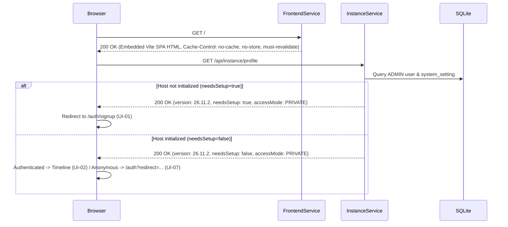
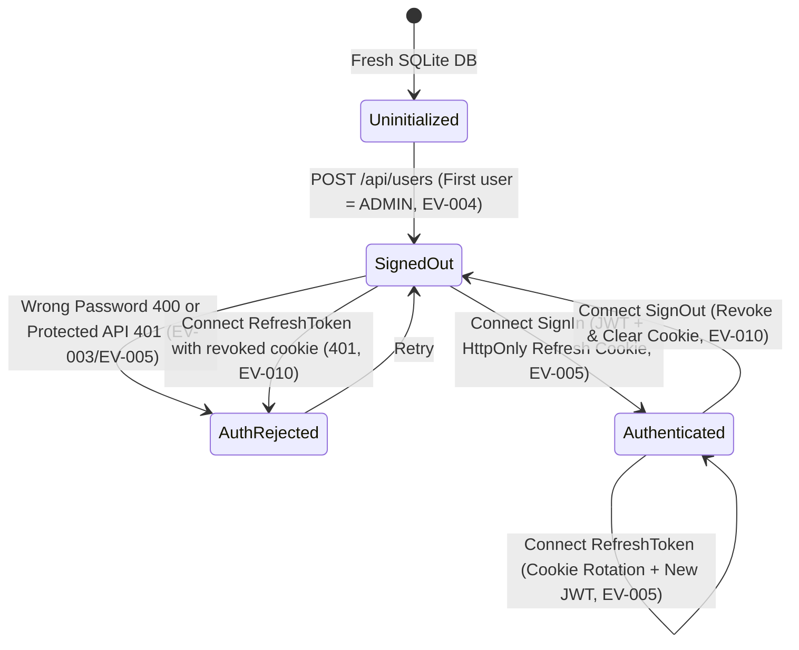
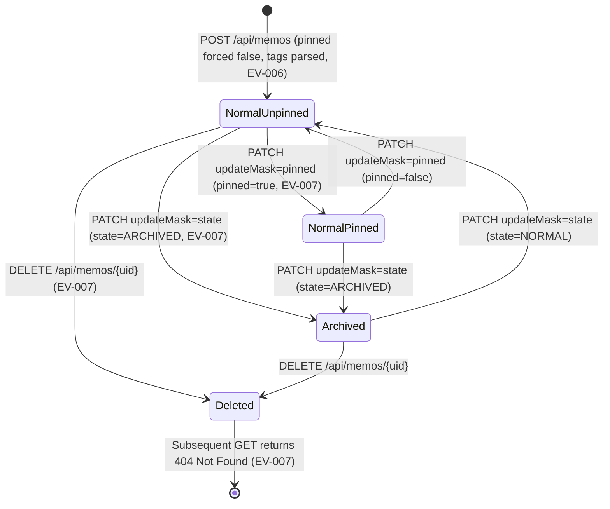
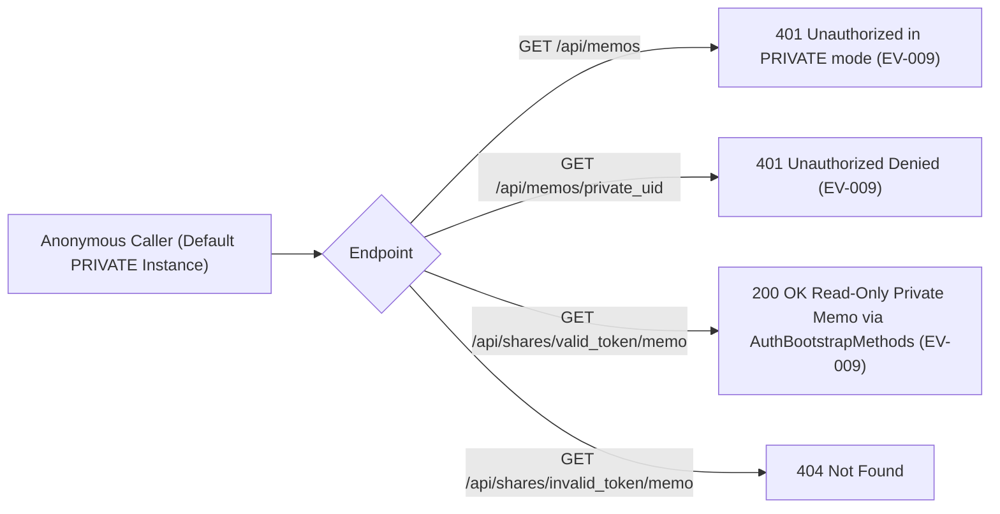
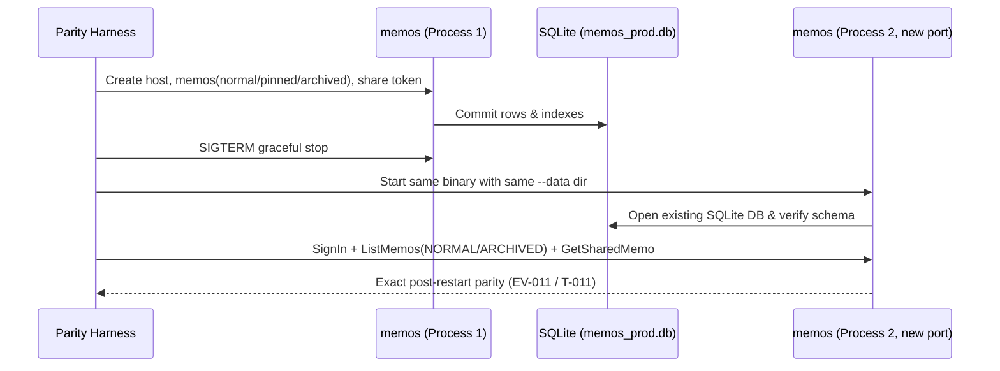

# 10. 실행·상태 도표 — `usememos/memos` 26.11.2 호출 순서 및 상태 전이 v1.0.0

본 문서는 `06_evidence/evidence_v1.0.0.jsonl`에서 관찰된 실제 호출 경로와 상태 전이 규칙을 기능 ID별로 구조화합니다. 모든 Mermaid 다이어그램은 호스트 테마 호환성을 위해 색상 하드코딩 없이 구조 전용으로 작성합니다.

---

## S1. 부트스트랩 및 임베디드 SPA 라우팅 (`F-001`, `F-002`)


- 근거: `[REF: server/frontend/frontend.go:42-119]`, `[REF: proto/api/instance_service.proto:20-23]`, `EV-001`, `EV-002`.

---

## S2. 인증·토큰 회전·로그아웃 폐기 전이 (`F-003`, `F-004`, `F-005`)


- 근거: `[REF: server/api/acl_config.go:11-80]`, `[REF: proto/api/auth_service.proto:15-48]`, `EV-003`, `EV-004`, `EV-005`, `EV-010`.

---

## S3. 메모 생명주기 상태 전이 (`F-006`, `F-007`)


- 근거: `[REF: proto/api/memo_service.proto:38-61]`, `EV-006`, `EV-007`.

---

## S4. CEL 필터 컴파일 및 검색 실행 흐름 (`F-008`)

```mermaid
flowchart TD
    Req["GET /api/memos?filter=..."] --> Parse["CEL Filter Parser (filter/engine.go)"]
    Parse -->|Unknown field or syntax error| E400["400 Bad Request (EV-008)"]
    Parse -->|Valid AST| Compile["SQLite Dialect Compiler"]
    Compile -->|tag in [...] | JsonEach["EXISTS json_each(payload.tags) COLLATE BINARY"]
    Compile -->|content.contains(s)| LikeEsc["LIKE ? ESCAPE '\\' (escape % and _)"]
    JsonEach --> Visibility["Inject Caller Visibility Predicate"]
    LikeEsc --> Visibility
    Visibility --> Query["Execute Parameterized SQLite Query"]
    Query --> Resp["200 OK JSON Memo List (Cache-Control: no-store)"]
```
- 근거: `[REF: filter/engine_test.go:171-205]`, `EV-008`.

---

## S5. 가시성 격리 및 비공개 공유 토큰 경계 (`F-009`)



---

## S6. 프로세스 종료(`SIGTERM`) 및 SQLite 영속 복구 (`F-010`)


