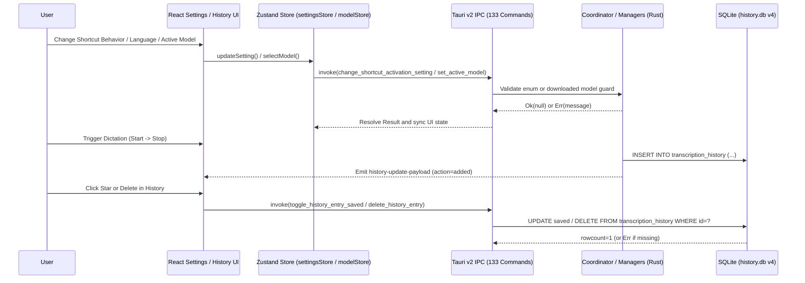

# 10 — Execution Paths & State Machines (`cjpais/Handy v0.10.2`)

## 1. Dictation Coordinator State Machine (`#dictation-state-machine`)
All three activation modes (`hold_or_toggle`, `push_to_talk`, `toggle`) route through a single pure `CoordinatorState` state machine in `src-tauri/src/transcription_coordinator.rs` `[REF: src-tauri/src/transcription_coordinator.rs:151-291]`. Recording begins on key-down; key-up is deferred by `RELEASE_GRACE` (`50ms`) to suppress X11 auto-repeat and classified against `hold_threshold_ms` (`300ms` default) `[REF: src-tauri/src/settings.rs:587-589]`.

```mermaid
stateDiagram-v2
    [*] --> Idle
    Idle --> Recording : key_down (Effect::Start / phase=started)
    Recording --> RecordingLocked : key_up < hold_threshold_ms (hold_or_toggle) or toggle mode (phase=locked)
    Recording --> Processing : key_up >= hold_threshold_ms or push_to_talk release (Effect::Stop / phase=stopped)
    RecordingLocked --> Processing : next key_down (Effect::Stop / phase=stopped)
    Recording --> Idle : cancel_operation (phase=cancelled, 0 DB writes)
    RecordingLocked --> Idle : cancel_operation (phase=cancelled, 0 DB writes)
    Processing --> Completed : ASR decode + optional post-process + SQLite INSERT
    Completed --> Idle : TranscriptionCompleteEvent (outcome=typed|empty|silent|failed) + HistoryUpdatePayload(added)
```

## 2. End-to-End Call Path (`#history-crud`, `#settings-load`, `#settings-mutation`)
Tracing from user interaction in the React frontend across Zustand stores, `tauri-specta` IPC, Rust managers, and SQLite persistence `[REF: src/components/settings/history/HistorySettings.tsx:144-284]` `[REF: src-tauri/src/managers/history.rs:335-600]`:



## 3. Model Lifecycle & Database Migration (`#model-lifecycle`, `#database-migration`)
- **Model Activation Guard**: `set_active_model(modelId)` validates that the requested model exists and `is_downloaded == true`, emits `model-state-changed` (`loading_started -> loading_completed`), and persists `selected_model` `[REF: src/components/model-selector/ModelSelector.tsx:76-101]` `[REF: src/stores/modelStore.ts:138-153]`.
- **SQLite Migration Order**: `HistoryManager::init_database` converts legacy `_sqlx_migrations` into `PRAGMA user_version`, runs `MIGRATIONS[0..3]` up to `user_version = 4` (tolerating `DatabaseTooFarAhead` from newer builds), then probes `pragma_table_info('transcription_history')` and adds missing nullable columns (`source_name`, `language`, `language_source`) `[REF: src-tauri/src/managers/history.rs:125-195]`.

## Sources Read
- `src-tauri/src/transcription_coordinator.rs` (`1-300`)
- `src-tauri/src/settings.rs` (`173-650`)
- `src-tauri/src/managers/history.rs` (`22-600`)
- `src/components/settings/history/HistorySettings.tsx` (`144-284`)
- `src/components/model-selector/ModelSelector.tsx` (`76-160`)
- `src/stores/modelStore.ts` (`138-153`)
