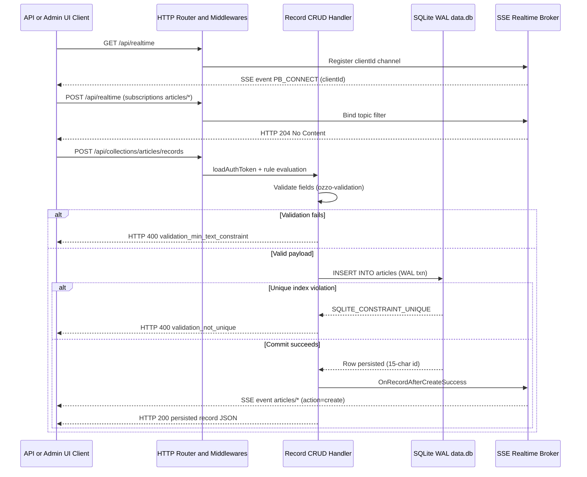
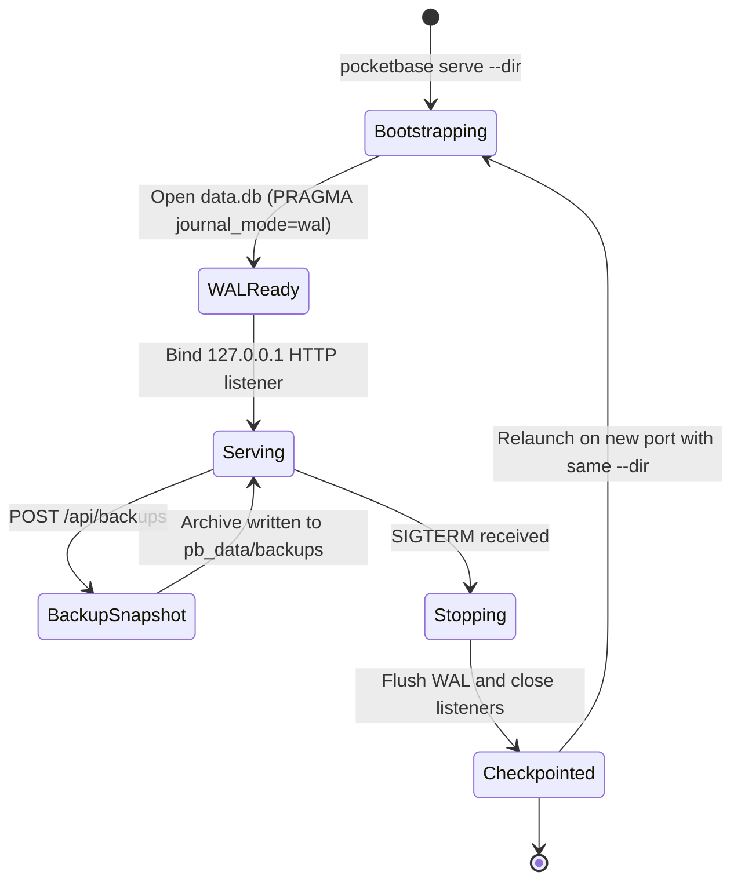
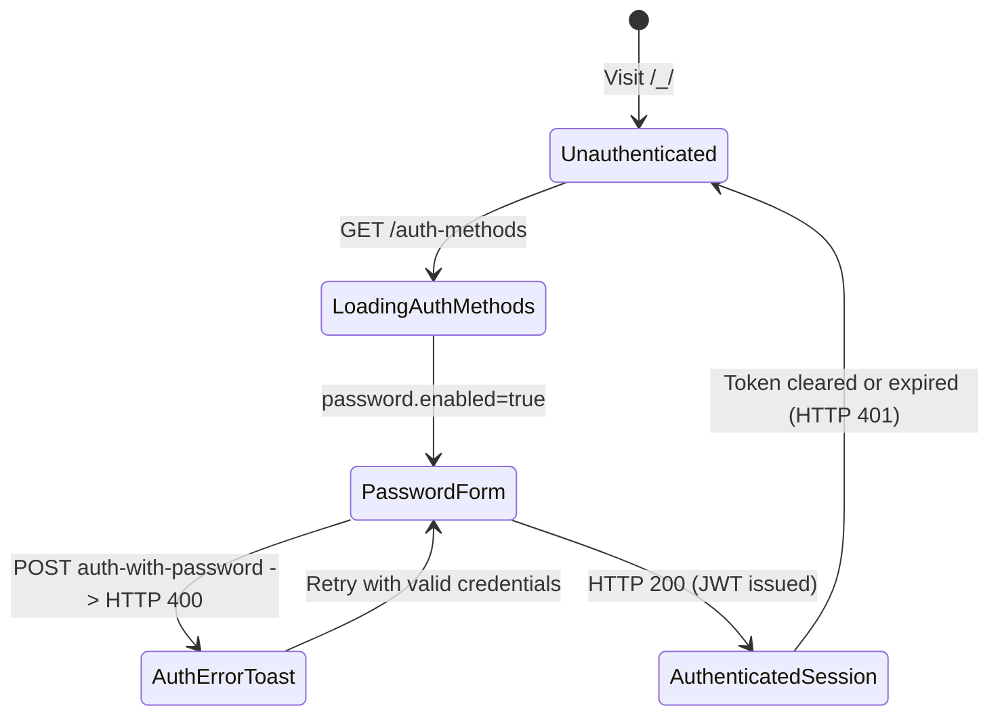

# 10 Execution & State Transition Diagrams

All diagrams follow the **Structure-Only Mermaid Contract** (no hardcoded node colors, `style fill:`, or `classDef` color literals) so they render cleanly in light and dark themes.

## 1. End-to-End Write, Persistence & Realtime SSE Broadcast (`F-007`, `F-009`, `F-012`)
Cited from `[REF: apis/record_crud.go:195-260]`, `[REF: apis/realtime.go:32-190]`, and `[REF: core/db.go:1-120]`.

## 2. Server Process Lifecycle & Restart Durability State Machine (`F-002`, `F-010`, `F-011`, `F-012`)
Cited from `[REF: cmd/serve.go:14-45]` and `[REF: apis/backup.go:18-130]`.

## 3. Superuser Authentication State Transitions (`F-004`, `F-005`)
Cited from `[REF: ui/src/auth/pageSuperuserLogin.js:1-120]` and `[REF: apis/record_auth_with_password.go:15-105]`.

## Sources Read
- `apis/record_crud.go`
- `apis/realtime.go`
- `apis/record_auth_with_password.go`
- `apis/backup.go`
- `cmd/serve.go`
- `core/db.go`
- `ui/src/auth/pageSuperuserLogin.js`
