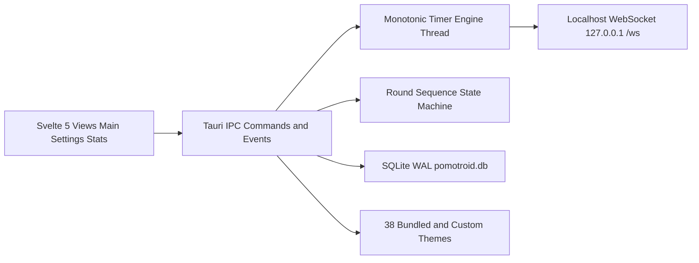

# 02 SDD — Pomotroid v1.7.1 Architecture & Design

## 1. System Topology
Pomotroid v1.7.1 uses a **Tauri v2 Rust backend** managing a drift-correcting monotonic timer thread (`std::time::Instant`), SQLite WAL storage (`rusqlite`), 38 compile-time embedded themes (`include_str!`), and an optional localhost WebSocket broadcaster (`127.0.0.1:1314/ws`), paired with a **Svelte 5 + SvelteKit static frontend** [REF: src-tauri/src/timer/engine.rs:1-74] [REF: src-tauri/src/db/mod.rs:1-25] [REF: src-tauri/src/websocket/mod.rs:1-40].

## 2. Core Algorithms & Concurrency
- **Drift-Correcting Ticker (`F-003`)**: Computes absolute next-tick deadline `seg.start + tick_interval * (seg.ticks + 1)` via `recv_timeout`, eliminating cumulative wakeup drift, and clamps stale `Prime` commands (`d.max(elapsed_secs + 1)`) so rapid skip/start races never cause spurious completion [REF: src-tauri/src/timer/engine.rs:187-244].
- **Round Sequencing (`F-005`..`F-007`)**: Tracks both `work_round_number` (resets per cycle) and monotonic `session_work_count`. When `long_breaks_enabled=false` and `short_breaks_enabled=true`, reaching `work_rounds_total` sets `work_round_number=0` during the substituted `ShortBreak` so the following `ShortBreak → Work` increment restores `1` [REF: src-tauri/src/timer/sequence.rs:77-120].
- **Storage & Migrations (`F-009`)**: `pomotroid.db` runs `PRAGMA journal_mode=WAL; PRAGMA foreign_keys=ON;` and applies transactional `MIGRATION_1` through `MIGRATION_6` (converting legacy `time_*_mins` keys ×60 into `time_*_secs` and seeding 7 local shortcuts) [REF: src-tauri/src/db/migrations.rs:5-135].
- **Security & Platform Boundaries**: WebSocket strictly binds `127.0.0.1`; CSP restricts `default-src 'self'`; macOS moves titlebar Settings/Stats controls to the right side to avoid overlapping traffic lights [REF: src/lib/components/Titlebar.svelte:181-195].

## Sources Read
- `src-tauri/src/timer/engine.rs`
- `src-tauri/src/timer/sequence.rs`
- `src-tauri/src/db/mod.rs`
- `src-tauri/src/db/migrations.rs`
- `src-tauri/src/websocket/mod.rs`
- `src/lib/components/Titlebar.svelte`
