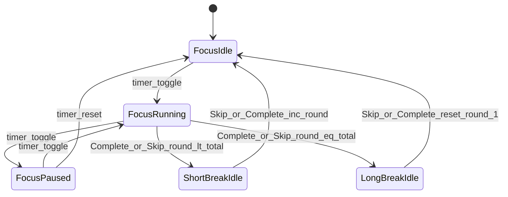

# 10 Execution Traces & State Transitions — Pomotroid v1.7.1

## 1. Timer Engine & Round State Machine

## 2. Verified Call Paths
- **Play/Pause (`F-003`)**: `Timer.svelte` Play button → `timerToggle()` → `TimerCommand::Start/Pause/Resume` → emits `timer:tick` / `timer:paused` / `timer:resumed` + WebSocket broadcast [REF: src/lib/components/Timer.svelte:143-162] [REF: src-tauri/src/timer/engine.rs:115-214].
- **Skip & Optional Breaks (`F-005`..`F-007`)**: `Timer.svelte` Skip button → `timerSkip()` → `SequenceState::advance()` → updates `round_type`, `work_round_number`, `session_work_count`, emits `timer:round-change` [REF: src-tauri/src/timer/sequence.rs:77-120].
- **Volume Persistence (`F-010`)**: `TimerFooter.svelte` slider `0..1` → `Math.round(val * 100)` → `settings_set("volume", "0".."100")` → SQLite `settings` upsert → emits `settings:changed` [REF: src/lib/components/TimerFooter.svelte:27-44].

## Sources Read
- `src/lib/components/Timer.svelte`
- `src-tauri/src/timer/engine.rs`
- `src-tauri/src/timer/sequence.rs`
- `src/lib/components/TimerFooter.svelte`
